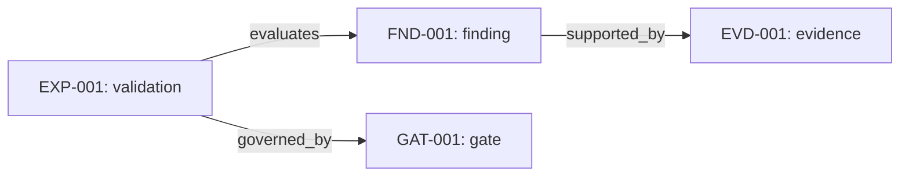

# RULES — Review knowledge-base design and authoring rules

This document specifies a Markdown and Mermaid knowledge base for the ongoing review of Kramerius, Akubra, and process-platform. It is a proposed authoring convention, not approval of any technical change. It was designed from the supplied brief; existing technical findings remain provisional unless their records contain stronger evidence. No repository investigation, telemetry query, or benchmark is implied by this design. The current review records live on `review/kramerius-architecture`; `main` keeps the reusable rules and quality-gate tooling.

<a id="rules-structure"></a>
## RULES / structure — Choose records by type, navigate by track

Two structures are viable:

| Option | Benefit | Cost |
| --- | --- | --- |
| Eight track folders, with records inside each | Familiar review outline | A storage optimization or rights finding can belong to several tracks, encouraging duplication and moves. |
| Records organized by type, with eight track indexes | Stable location and one authoritative record; many navigation views | Requires a small amount of metadata and index generation. |

Use **records by type**. Tracks are views, not separate copies of facts. A record may belong to multiple tracks:

1. `bugs` — defects and correctness concerns.
2. `optimization` — code and request/job efficiency.
3. `modularization` — responsibilities, ownership, APIs and deployment boundaries.
4. `akubra` — storage ideas and benchmark designs.
5. `review-process` — AI, maintainer, operator and contractor collaboration.
6. `capabilities` — new user or operational behavior.
7. `abstraction` — contracts that enable technology transitions.
8. `benchmarks` — workloads, resource budgets and acceptance gates.

The graph is the collection of explicit relationships between records. Markdown files remain authoritative. Mermaid diagrams and generated indexes are views of those files.

<a id="rules-types"></a>
## RULES / types — Seven record types

| Type | ID | Purpose |
| --- | --- | --- |
| Subject | `SUB-001` | A system, module, use case, review process, or versioned repository/workload/deployment profile. Use `subtype` to distinguish them. |
| Finding | `FND-001` | A reported defect or correctness concern. Confirmation is a separate field; the name does not establish that it is a bug. |
| Proposal | `PRP-001` | An optimization, modularization design, storage idea, abstraction or new capability, including alternatives. |
| Evidence | `EVD-001` | A bounded source analysis, runtime observation or benchmark result, with provenance and limitations. |
| Experiment | `EXP-001` | A validation or benchmark design and its execution state. Results belong in linked evidence records. |
| Gate | `GAT-001` | An acceptance contract tied to specific use cases, profiles, limits and assessment rules. |
| Decision | `DEC-001` | A dated choice, its authority, rationale and consequences. |

Do not create a separate record for every sentence, source file or diagram node. Create one when it has an independent lifecycle, evidence, owner or decision. Detailed steps and observations can remain sections of their parent record.

<a id="rules-identifiers"></a>
## RULES / identifiers — Stable names and legacy compatibility

- Use immutable IDs with a type prefix and at least three digits: `FND-001`, `PRP-012`. Never reuse an ID or encode priority, year, owner, status, track or directory position into it.
- Migrate `B1` to `FND-001`, through `B26` to `FND-026`. Preserve the old value in `aliases`, such as `aliases: [B1]`. Allocate subsequent findings from `FND-027`; do not introduce new `B27` identifiers.
- Filenames are IDs: `findings/FND-001.md`. A changed title does not move the file. The H1 is `# FND-001 — Descriptive title` and must match metadata.
- Every titled section has a stable document-local identifier, for example `FND-001 / evidence`. Put an explicit anchor before the heading, such as `<a id="fnd-001-evidence"></a>`. Use that anchor in links; do not rely on a renderer's title-derived slug.
- A heading identifier is not an independent graph node. Promote a section to a record if other work must independently evaluate, own, accept or supersede it. Leave a link at the old anchor.
- Index pages and these rules may use fixed names, such as `INDEX` and `RULES`, with local anchors following the same convention.
- An ID survives rejection. If a finding is actually a feature request, close it with that resolution and create a linked proposal; do not silently change the record's type or recycle its ID.
- Allocate IDs when merging a new record. Draft branches may use obvious placeholders; resolve collisions before merge. A generated ID index identifies the next available number.

<a id="rules-metadata"></a>
## RULES / metadata — Common envelope and evidence semantics

Every record starts with this envelope. Replace placeholders before publishing it as a live record; use YAML `null` for an unassigned owner or unknown revision.

```yaml
---
id: FND-001
type: finding
title: "Title copied from the reviewed material"
aliases: [B1]
tracks: [bugs]
status: draft
owner: null
reviewers: []
evidence_basis: [hypothesis]
created: YYYY-MM-DD
updated: YYYY-MM-DD
---
```

`status` describes workflow, not truth. Allowed states:

| Type | Status values |
| --- | --- |
| Subject | draft, active, retired |
| Finding | draft, in-review, open, closed |
| Proposal | draft, in-review, accepted, rejected, deferred, superseded |
| Evidence | draft, reviewed, superseded |
| Experiment | draft, ready, running, completed, cancelled |
| Gate | draft, agreed, superseded |
| Decision | proposed, accepted, rejected, superseded |

`evidence_basis` is a set drawn from `hypothesis`, `source`, `runtime`, and `benchmark`; use an empty list where no technical claim is made. It is a navigation aid, not a confidence score. Every substantive claim must link to the specific evidence that supports it. A source finding can be certain about checked-out code while its production exposure is unknown. Runtime correlation does not establish causation. A benchmark result is valid only for its recorded conditions. Mixed records label individual claims separately.

Findings also record `assessment: unverified | supported | contradicted | mixed` and a separate `production_exposure: unknown | observed | ruled-out-for-profile`. Closing a finding requires a resolution such as repaired, rejected, duplicate or accepted-risk, with a linked decision/evidence as appropriate. Closing it does not delete the original claim.

<a id="rules-templates"></a>
## RULES / templates — Content required for each type

Compose each template from the common metadata, its fields below, and the common relationship/history footer. Every named section receives an ID/anchor following the heading rule above. These are authoring templates, not assertions about the current systems.

| Type | Additional metadata | Required sections |
| --- | --- | --- |
| Subject | `subtype: system | module | use-case | process | repository-profile | workload-profile | deployment-profile`; `version: null` | **Purpose and scope**; **Responsibilities or user outcome**; **Interfaces and owned data** for modules; **Exact parameters and provenance** for profiles; **Known constraints and unknowns**. |
| Finding | `assessment: unverified`; `production_exposure: unknown`; `severity: unassessed`; `resolution: null` | **Claim and expected invariant**; **Trigger and affected scope**; **Evidence and counterevidence**; **Impact and uncertainty**; **Validation scenario**; **Candidate repair direction**. |
| Proposal | `category: optimization | modularization | storage | capability | abstraction | process`; `decision: pending` | **Problem/user need**; **Current behavior and evidence**; **Options including retaining current behavior**; **Proposed contracts and ownership**; **Effects to measure**; **Risks/dependencies**; **Migration and rollback**; **Acceptance gates**. |
| Evidence | `kind: source | runtime | benchmark`; `source_revision: null`; `deployment_match: unknown`; `collected_at: null` | **Supported claim**; **Source/artifact and immutable revision or time window**; **Method and scope**; **Observation**; **Interpretation**; **Limitations and contrary evidence**. For benchmark evidence, include the experiment/run manifest and measured results. |
| Experiment | `execution: not-run`; `run_ids: []` | **Question and candidate**; **Baseline and comparison**; **Pinned profiles**; **Procedure and repeat policy**; **Metrics and correctness checks**; **Predeclared gates**; **Confounders**; **Execution log and result links**. |
| Gate | `version: 1`; `approval: pending` | **User/operational requirement**; **Applicable use cases**; **Pinned profiles**; **Metric/limit table**; **Correctness and recovery conditions**; **Aggregation and pass/fail rules**; **Approver and rationale**. |
| Decision | `outcome: pending`; `decided_at: null`; `authority: null` | **Question**; **Considered options**; **Evidence available and missing**; **Choice and rationale**; **Consequences/conditions**; **Follow-up owner**; **Revisit trigger**. |

Common footer, shown without document-specific anchors:

```markdown
## <ID> / relationships — Relationships

| Relation | Target | Why this connection matters |
| --- | --- | --- |
| affects | [SUB-001 — Subject title](../subjects/SUB-001.md) | Specific affected behavior. |

## <ID> / history — History

| Date | Change | Actor or review reference |
| --- | --- | --- |
| YYYY-MM-DD | Draft created; claims remain provisional. | Actual author/review reference. |
```

Use Git history for edits. Record material changes in the history table: revised claim, new contradictory evidence, changed scope, acceptance or supersession. Decision records carry the decision history; do not copy their rationale into every related file.

<a id="rules-relationships"></a>
## RULES / relationships — Canonical edges and links

Use these typed relationships in the canonical relationship table:

| Relation | Direction and meaning |
| --- | --- |
| `affects` | Finding/proposal/gate → subject or use case. |
| `supported_by` | Claim-bearing record → evidence supporting a particular claim. |
| `challenged_by` | Claim-bearing record → evidence that limits or contradicts it. |
| `depends_on` | Record → prerequisite record. Explain the prerequisite. |
| `evaluates` | Experiment → finding or proposal. |
| `uses` | Experiment/gate → versioned repository, workload or deployment profile. |
| `governed_by` | Proposal/experiment → acceptance gate. |
| `produced_by` | Benchmark evidence → experiment, with run ID stated in its body. |
| `decides` | Decision → finding, proposal, gate or process subject. |
| `supersedes` | New record → older record, normally of the same type. |

Use ordinary relative Markdown links with the target's ID and short title as the label. Relationships in prose are useful but the relationship table is the canonical source for graph generation. Store each edge once; generate backlinks. For example, an experiment links to the proposal it evaluates, and the proposal's generated backlinks reveal that experiment.

Do not repeat observed facts in several authoritative records. The evidence record owns the observation; a finding or proposal states its interpretation and links to it. Indexes contain short navigation summaries and metadata. When a profile or accepted gate changes substantively, create a new version/record and link `supersedes`; past results must continue to reference the exact old conditions.

<a id="rules-layout"></a>
## RULES / layout — Files and navigation

```text
RULES.md
review-plan.md                  # Review-branch execution checklist
review/                         # Existing reports, retained with provenance
kb/
  README.md                     # Start here: tracks, priorities, open questions
  subjects/SUB-001.md
  findings/FND-001.md
  proposals/PRP-001.md
  evidence/EVD-001.md
  experiments/EXP-001.md
  gates/GAT-001.md
  decisions/DEC-001.md
  tracks/                       # Eight small curated introductions + generated lists
  maps/                         # Curated conceptual/sequence diagrams
  templates/                    # Seven composed record templates
  generated/                    # ID/alias index, backlinks, graph and coverage views
  tools/                        # Small local validation/generation scripts
```

The landing page links to the eight tracks, subject map, findings by severity/assessment, open decisions, benchmark readiness and evidence gaps. A record should be reachable through both its track and its subject. Keep generated content clearly marked and deterministic; authors edit the records, not generated tables.

<a id="rules-diagrams"></a>
## RULES / diagrams — Mermaid conventions

- Maintain sequence diagrams, current/proposed architecture diagrams, and carefully scoped call-flow diagrams manually. They express behavior that cannot be derived from relationship links alone.
- Generate local relationship graphs, backlinks and track summaries from records. Avoid one enormous graph; show a subject neighborhood or one decision and its evidence, proposals and gates.
- Use stable record IDs as node identities. Convert hyphens to underscores for Mermaid node identifiers: `FND_001`. Labels include the canonical ID and a short title.
- Label edges with their relation or call meaning. State whether a diagram is a **knowledge graph**, **source call graph**, **observed runtime flow**, or **proposed design**. A call graph does not establish frequency or elapsed cost.
- Give every diagram a caption with its scope, source record links, revision/date where available, and unresolved assumptions. Use shapes/labels as well as color; do not convey provisional status through color alone.
- Add Mermaid `click` links where the chosen Markdown viewer supports them. Always place an ordinary Markdown node-link list/table below the diagram because some viewers disable Mermaid navigation. Check relative-link behavior in the selected viewer before relying on diagram clicks.

Illustrative syntax, not an assertion about B1:



<a id="rules-gates"></a>
## RULES / gates — Benchmark acceptance is a versioned contract

A gate links to three explicit profile types and one or more use cases:

| Profile | Required description |
| --- | --- |
| Repository | Object/datastream counts, total bytes, FOXML size distribution, hierarchy depth, OCR/PDF/image mix, index size and relevant collection/folder cardinality. A tier name alone is insufficient. |
| Workload | Route/job mix, request and response sizes, arrival rate/concurrency, query classes, read/write mix, cache state, warm-up and measurement duration, repeats and background indexing load. |
| Deployment | Application/schema/dependency revisions, topology, CPU/RAM/storage/network budgets, NFS/S3 behavior, image-server placement and configuration. |

Use a gate table like this; values are deliberately unset:

| Resource/use case | Metric and measurement boundary | Limit | Conditions | Evidence/run |
| --- | --- | --- | --- | --- |
| Named API operation | End-to-end p95/p99 latency at declared offered load | TBD | Profile IDs; payload/cache/rights class | Not run |
| Named API operation | Successful requests/s and error/timeout rates | TBD | Same profiles; classify expected 4xx separately | Not run |
| Indexing job | Full duration, documents/s and visibility delay | TBD | Fixed dataset and concurrent public workload | Not run |
| Image opening | Browser time-to-image plus individual resource latency | TBD | Declared image and upstream/cache conditions | Not run |
| Recovery scenario | Time to recovery and state invariants | TBD | Declared injected failure and retry policy | Not run |

The owner and human approver agree limits from user/operational needs and a feasible resource budget before comparing options. Do not turn an existing observed percentile into a satisfactory limit automatically. Define percentile calculation, minimum sample adequacy, timeout treatment, repeat aggregation and allowed regression before running. An incomplete gate with TBD limits cannot pass.

A run result is `pass`, `fail`, or `inconclusive` against a specific gate version and profile set. A gate passes only when every required correctness, latency, throughput, error and recovery condition holds under the agreed resource budget. Publish missing observations and run-to-run variation. Keep healthy-operation performance separate from incident availability; measure mixed-load interference where relevant. Do not infer performance for larger repository tiers that were not assessed.

<a id="rules-workflow"></a>
## RULES / workflow — AI, people and contractors

1. **Draft:** AI or a person creates a bounded record with provenance and unknowns. Mark the authoring method in history. AI may assist with source tracing, graph generation, summaries and experiment specifications; its output is not independent corroboration of its own claim.
2. **Evidence review:** A maintainer verifies source interpretation and affected revisions; an operator checks deployment/telemetry context; the relevant domain reviewer checks behavior such as rights or repository consistency. Record actual reviewers when assigned, otherwise leave them unassigned.
3. **Prioritization:** The accountable technical/product owner selects a finding or proposal based on risk, user value and dependencies. Unknown frequency remains unknown.
4. **Validation design:** The benchmark owner supplies versioned profiles and a gate. Execution remains with the separately prepared benchmarking environment. Source-only review can progress without pretending that the experiment is complete.
5. **Decision:** A named human authority records acceptance, rejection or deferral with evidence and remaining conditions. Accepted design and accepted implementation are separate decisions where necessary.
6. **Delivery and follow-up:** Link implementation work, later result evidence and revisit conditions. Preserve superseded and rejected records for traceability.

A contractor receives a bounded set of IDs, specific deliverables, access/data constraints, checkpoints and acceptance criteria. Examples of deliverables are an independent contract review, benchmark harness, measured run report or implementation patch. Contractor authorship does not replace maintainer acceptance. The knowledge base itself does not authorize production changes or sharing material externally.

<a id="rules-migration"></a>
## RULES / migration — Preserve the existing review

1. Inventory existing documents, headings, diagrams and links without renaming or deleting them. Record the original path and Git revision where available; otherwise explicitly say the revision is unknown.
2. Create an ID/alias mapping for B1–B26. Copy each claim faithfully into its finding record, retaining original qualifications and linking to its originating report. Migration does not confirm the claim or production exposure.
3. Keep numbered reports at their current paths as historical review snapshots. Add a small migration/navigation note linking to extracted records. Preserve existing heading anchors; direct new updates to the canonical records instead of maintaining two evolving copies.
4. Extract evidence at a useful scope. A bounded report section can support several findings through one evidence record. Distinguish what the old report asserted from a later independent verification. Never relabel an old source inference as runtime evidence.
5. Keep the review branch's `review-plan.md` as the execution checklist, linking to record IDs and track views. Keep the review form as intake guidance and point it to the new templates. Preserve the benchmark handoff as a source document while extracting experiment/profile/gate records with all unknown limits intact.
6. Retain existing source call graphs and boundary diagrams with their original provenance. Add node links to subjects/findings where known; do not manufacture a type-resolved or runtime graph from a conceptual drawing.
7. Generate indexes/backlinks and check compatibility links before treating a migrated record as canonical. Migration status and technical validation status are separate.

<a id="rules-examples"></a>
## RULES / examples — Two worked record shapes

These examples illustrate structure only. IDs other than the defined B1 mapping are illustrative and do not allocate records. Double-braced values are placeholders to resolve during migration; they are not valid published links.

**Finding example: migrate B1 without inventing its technical content.**

```text
ID: FND-001
Aliases: B1
Title: {{original B1 title}}
Status: draft
Assessment: unverified
Owner: unassigned
Claim: {{original claim, including its qualifications}}
Scope: {{affected module and revision stated in original material}}

Relationships:
  affects       -> {{SUB ID for the affected module}}
  supported_by  -> {{EVD ID for the original bounded source analysis}}

Validation EXP record:
  evaluates     -> FND-001
  uses          -> {{repository/workload/deployment profiles}}
  Scenario: {{original trigger}}; assert {{expected invariant}}.
  Execution: not-run.
```

The module subject is reached from the finding. The evidence record links to the original report and identifies revision uncertainty. Generated backlinks make the validation experiment visible from the finding. Nothing in this example claims what B1's actual defect is; that must come from migration of its existing text.

**Architecture example: a draft proposal for clearer module ownership.**

```text
ID: PRP-001 (illustrative)
Category: modularization
Title: Define module ownership before selecting deployment boundaries
Status: draft
Evidence basis: hypothesis
Owner: unassigned

Options:
  A. Retain current ownership and deployment.
  B. Introduce explicit internal APIs/data ownership in the current deployment.
  C. Extract selected modules into separately operated services.

Relationships:
  affects       -> {{affected module and use-case SUB records}}
  depends_on    -> {{PRP records for required write/rights/state contracts}}
  governed_by   -> {{GAT records for affected API/job performance and correctness}}

EXP record: evaluate alternatives at equal total deployment resources,
using the same repository and workload profiles; assess failure behavior
and operational burden as well as timing.

DEC record: no choice accepted yet; authority unassigned.
```

Its gate links to exact profiles and to affected use cases. A later benchmark result becomes evidence; a decision can then select an option with conditions. The example proposes a review structure and does not assert that any extraction will improve performance.

<a id="rules-automation"></a>
## RULES / automation — Small checks, no database

Start with one local validation command and one deterministic generation command. They may later run in CI:

- Validate frontmatter, allowed types/statuses, ID uniqueness, alias uniqueness, H1/filename agreement and required sections.
- Validate local file/anchor links, relationship types and target types. Report unknown owners and missing evidence as readiness gaps, not fabricated values.
- Reject published placeholder IDs and unresolved merge collisions. Allow draft records with explicit unknown fields; prevent an agreed gate from retaining unset required limits or approval.
- Flag findings with an asserted observed production exposure but no runtime evidence, and completed experiments without result/evidence links. Human review still determines whether the evidence actually supports the claim.
- Generate ID/alias and track indexes, backlinks, gate-readiness lists and bounded Mermaid relationship diagrams from canonical records.
- Check that generated files are current and deterministic. Preserve manually authored prose outside marked generated blocks.

Use ordinary Markdown navigation as the baseline. Viewer-specific features are optional enhancements. No graph database, custom web application or external publishing service is required.

<a id="rules-first-slice"></a>
## RULES / first-slice — First implementation without benchmarks

- [ ] Create `kb/README.md`, the seven templates and a minimal ID/alias index.
- [ ] Reserve the mapping B1–B26 → FND-001–FND-026; migrate one existing finding with its qualifications intact.
- [ ] Create its actual affected-module subject, one provenance-bearing evidence record and one not-run validation experiment. Resolve the example placeholders from the existing material during that implementation task.
- [ ] Create one draft architecture proposal with alternatives and a draft gate whose unknown profiles/limits are explicit.
- [ ] Add one small Mermaid neighborhood graph and ordinary Markdown links beneath it.
- [ ] Link the existing plan, report and review form to the new records while preserving their current paths and anchors.
- [ ] Add/check ID, local-link and relationship validation, then review the slice with a maintainer for usability and evidence accuracy.

This slice demonstrates navigation, stable IDs, provenance, decisions and benchmark readiness without running a benchmark or changing application behavior.
