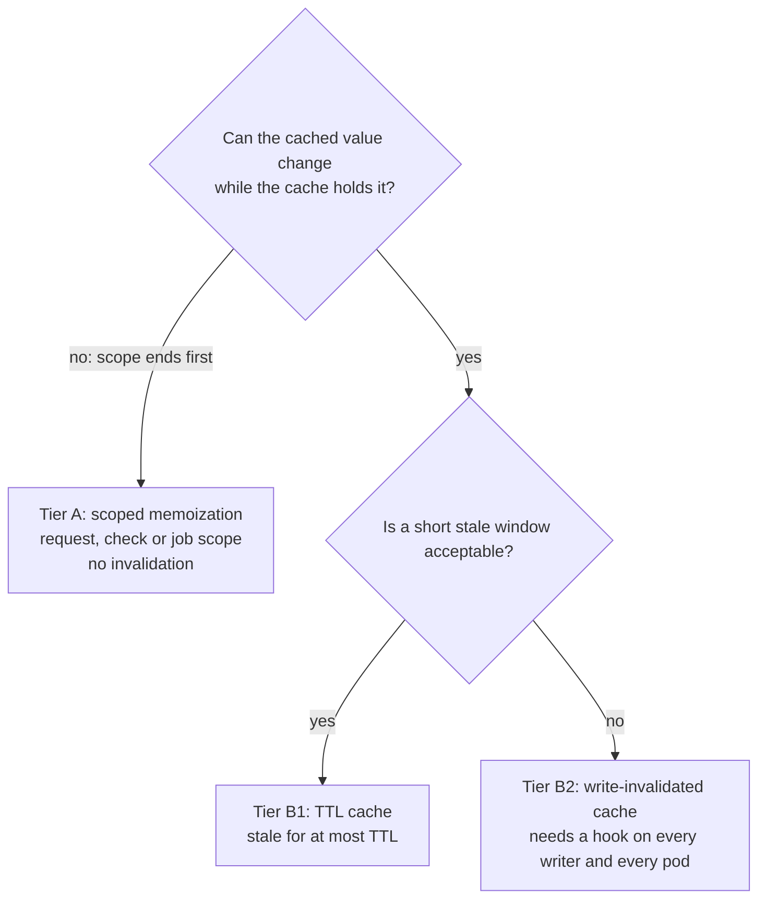

# PH-001 — Add caches in two tiers, split by whether they need invalidation on write

> **In one sentence:** Kramerius re-reads the same Solr documents and FOXML many times per request and across requests, so we should first remove repeats that need no invalidation at all, then add a few cross-request caches for data that rarely changes, each with an explicit invalidation owner.

## Today

Every image request goes through the same reads, and almost none of them are reused:

| Read | Where | Measured cost (2026-10-27 traces) |
| --- | --- | --- |
| Requested PID's Solr document, once per licence evaluated | rights check, `Licenses.evalute` | 5.6 identical GETs per check, **~104 ms wasted per check** ([PS-002](../perf-simple/PS-002-rights-check-refetches-solr-doc.md)) |
| Whole rights decision | `RightsResolverFromRequest.isActionAllowed` | **276 ms** per direct IIIF request, **314 ms** per forwarded, **567 ms** per item API request (6.3 checks) |
| RELS-EXT-derived image-server URL | `IIIFUtils.iiifImageEndpoint` | p50 13–33 ms, p95 ~100–110 ms, on every IIIF `info.json` and forwarded tile |
| FOXML of the PID and its ancestors | access logging enrichment | ~3 reads, **68 ms** per logged request ([PM-003](../perf-medium/PM-003-batched-access-log-writer.md)) |
| PID paths from Solr | `SolrAccessImplNewIndex.getPidPaths` | p50 9 ms, p95 89 ms, 1.5 calls per forwarded request |

These run on a large volume of requests. On 2026-10-19 there were 1.29M direct IIIF tile GETs, 61k direct and 86k forwarded
`info.json` GETs, 156k forwarded tiles and 878k thumbnails ([baseline](../raw/01-baseline.md)).

Some caches already exist ([cache matrix](../raw/03-cache-matrix.md)). None has write invalidation, and two have known defects:

- `CachedSolrAccessImpl`: PID to Solr document, 60 s TTL, per JVM. It is used only by direct IIIF and CDK source lookup,
  not by rights checks.
- `RightsResolverFromRequestCached`: A_READ decisions, wired only to the Zoomify tile route. Its key leaves out path and stream
  (review finding **B2**), so it can return the wrong path's decision.
- `DCContentUtils`: a static map with no synchronization and no invalidation (**B3**).

## Idea

Sort every cache candidate by **what has to happen when the data changes**:

### Tier A: no invalidation needed (do first)

The cache lives only as long as one rights check, one request or one indexing job, so it cannot outlive a write that matters to it.

| # | Candidate | Scope | What it removes |
| --- | --- | --- | --- |
| A1 | Requested PID's Solr document, shared by all licence criteria | one rights check | the ~104 ms of repeats per check ([PS-002](../perf-simple/PS-002-rights-check-refetches-solr-doc.md)) |
| A2 | Solr document and PID paths, shared by `getPidPaths`, rights and logging | one request | the remaining first fetch per check, and duplicate path lookups |
| A3 | Parsed FOXML and RELS-EXT of the requested PID, shared by `iiifImageEndpoint` and logging | one request | the leaf object is read twice per request today (source reading, not yet measured) |

Tier A changes no semantics: every read sees the same data it would see today within the same request.

### Tier B: needs invalidation (do after A, one candidate at a time)

| # | Candidate | Key | Changes when | Freshness approach |
| --- | --- | --- | --- | --- |
| B1 | Image-server URL per PID (`iiifImageEndpoint`) | PID | RELS-EXT `tiles-url` changes: re-import, image migration (rare) | TTL of minutes, plus eviction from the import and RELS-EXT write paths |
| B2 | Rights decision, **tile routes only** | PID, **path**, stream, action, user roles and licences, IP class | rights or licence edits, user role changes, licence assignment in Solr after reindex | 60 s TTL (captures ~97% of tile reuse), fix the B2 key first, explicit "revoke now" eviction |
| B3 | Parsed FOXML projections of ancestors for logging | PID | any FOXML write | not needed if [PM-003](../perf-medium/PM-003-batched-access-log-writer.md) moves enrichment to a batch worker |
| B4 | Search responses | query, filters, sort, page, index generation, auth context | every index commit, rights changes | last; measure Solr's own caches first, which may already cover this |
| — | Whole-FOXML cache | — | every write | **not proposed**: narrower projections cover the measured reads with far less invalidation |

**Invalidation across pods.** There are at least two public pods plus workers, and a local eviction reaches only one JVM.
Options, simplest first:

1. **TTL only**, with an agreed maximum staleness per candidate. This needs no new infrastructure and fits B1.
2. **Broadcast eviction.** Writers publish "PID changed" and every JVM evicts it. Hazelcast already runs in the stack
   (for locks) and could carry a topic.
3. **Version in the key.** Akubra keeps a per-object `lastModifiedDate` in FOXML `objectProperties` and sets it on every
   write through `AkubraDOManager.write` (ingest and datastream changes) and `deleteStream`. But
   `AkubraRepository.getMetadata(pid)` reads the **whole FOXML** from NFS to return it, so checking the version costs as much
   as the read it is meant to save. The indexer copies the same value into the Solr search document as `modified`
   (`SolrInputBuilder.java:235`), and each request already loads that document for paths and rights (A2). A cache keyed on
   `(PID, modified)` therefore needs no extra read. Its freshness lags until the object is reindexed, which matches the
   point at which search results change anyway. Writes that bypass Akubra (direct file edits) change neither value.

## Expected gain

| Use case | Candidate | Today | After (rough) | Confidence | Basis |
| --- | --- | --- | --- | --- | --- |
| image-open, all IIIF and forwarded | A1 | rights ~276–314 ms per request | ~100 ms less | high | method spans + URL-hash counts |
| item API (`/search/api/*`) | A1 | 6.3 checks, ~567 ms | ~6 × 100 ms less at worst; real figure depends on licence count | medium | method spans |
| image-open, tiles and forwarded `info.json` | B1 | p50 13–33 ms, p95 ~100 ms per request | ~0 on 83–97% of requests | medium | method spans + PID reuse |
| image-open, tiles (direct and forwarded) | B2 | ~276–314 ms rights per request | ~0 on up to ~97% of requests with a 60 s TTL | medium | method spans + PID reuse; real key includes user |
| thumbs, items, direct `info.json` | B1, B2 | as above | little: PID reuse is only 16–31% | high | PID reuse |
| Solr load | A1 + A2 | ~5.6 document GETs per rights check | ≤ 1 | high | URL-hash counts |

**How often a PID repeats** (NGINX logs, 6 hours on 2026-10-27, successful GETs, counted with hashes in tumbling windows;
an upper bound for a per-PID cache):

| Route | Requests | Same PID again within 1 min | 5 min | 15 min | 60 min |
| --- | ---: | ---: | ---: | ---: | ---: |
| direct tile | 436,002 | **0.97** | 0.97 | 0.98 | 0.98 |
| forwarded tile | 47,107 | **0.96** | 0.97 | 0.97 | 0.97 |
| forwarded `info.json` | 17,728 | **0.83** | 0.84 | 0.85 | 0.85 |
| thumb | 255,052 | 0.23 | 0.27 | 0.29 | 0.31 |
| other item | 107,848 | 0.17 | 0.19 | 0.20 | 0.22 |
| direct `info.json` | 15,912 | 0.16 | 0.18 | 0.19 | 0.20 |

Tiles come in bursts: one image is many tiles for the same PID, read within seconds. A **60 s TTL captures nearly all the
reuse**, so tier B for tiles needs only a short staleness window.

**Caveat: the direct-tile figure is inflated by one synthetic client.** A single internal client sends 30–38% of all direct
tile requests (about 6 per second, nonstop), always for **one** PID with one user agent and one referrer. It is **BotTheCurator**, the library's own synthetic speed
check: a headless browser that keeps opening one viewer page. It is not a reader. Because it always hits the same warm image, its own latency figures
are best-case. Without it, readers still make ~300k tile requests over ~9.5k PIDs in 6 hours, so reuse stays high, but the
per-minute figure must be re-measured without that client. Forwarded tiles come from the CDK portal, which is another
Kramerius serving real readers, and are not affected. Forwarded `info.json` repeats too. Other routes barely repeat,
even over an hour, so tier B does little for them; tier A is what helps there.

Gains overlap: A3 and B3 remove the same FOXML reads as PM-003, and B2 hides most of A1's benefit on cache hits.
Measure each candidate separately.

## Pros

- Tier A is pure waste removal: no staleness, no new infrastructure, and it can ship as a few small changes.
- Fewer Solr queries and NFS reads per request, so Solr and NFS tails hit fewer requests.
- Tier B is opt-in per candidate. Each one states its staleness and invalidation owner before it is built.

## Cons and risks

- Tier B introduces stale reads by design. For rights (B2), a revoked licence keeps working for up to the TTL unless
  eviction is reliable.
- Cache keys can be wrong without anyone noticing. The existing rights cache already has this bug (B2).
- Memory per JVM, and a cold start after every deploy.
- Writers outside Kramerius (external tools, direct Akubra writes) bypass eviction hooks. Only TTL protects against them.

## Alternatives

1. **Do nothing.** Every rights check keeps re-reading Solr, and image requests keep paying ~100–300 ms for repeated lookups.
2. **Tier A only.** Captures the certain win (~100 ms per rights check) with no correctness risk. Size S.
3. **One generic cache layer** (e.g. Ehcache or Caffeine around `SolrAccess` and `AkubraRepository`). Simpler to add, but it
   hides key and freshness decisions in one place and invalidates poorly. Not recommended.
4. **Shared external cache** (Redis, memcached). Solves cross-pod consistency but adds a network hop per lookup and new
   infrastructure. Only worth it if broadcast eviction proves insufficient.

## Effort

**Size: L** overall, because tier B needs eviction hooks on writers in several modules and works across pods.
Each stage can ship and be measured on its own.

| Part | Size | Why this size |
| --- | --- | --- |
| A1: Solr document memoized per rights check (= PS-002 fix) | S | criteria context and four criteria classes, one module |
| A2 + A3: request-scoped holder for Solr document, paths and parsed FOXML | M | new request-scoped component wired into rights, IIIF and logging |
| B1: image-server URL cache with TTL and eviction on RELS-EXT writes | M | new cache plus hooks in import and datastream write paths |
| Fix the rights-cache key (B2) before any wider use | S | key change in `RightsResolverFromRequestCached` |
| B2: rights decision cache on all protected routes | L | freshness contract, revocation path, cross-pod eviction |
| Broadcast eviction (Hazelcast topic) | M | new channel used by several writers |

Depends on: agreed maximum staleness for B1 and B2, and the list of all RELS-EXT and rights writers, including external ones.

## How we would validate it

1. **Tier A:** Solr GETs per `isActionAllowed` drop from ~5.6 to ≤ 1. `isActionAllowed` p50 drops by about 100 ms.
   Rights decisions are identical before and after on a fixed request set.
2. ~~Hit-rate estimate for tier B~~ (done, see the reuse table above): tiles and forwarded `info.json` qualify. Thumbs, items and
   direct `info.json` do not. Recheck at peak, without the synthetic tile client, and with the user in the key for B2.
3. **Tier B, per candidate:** staging run with reads from both public pods while RELS-EXT, rights and licences change. Measure the
   stale window, hit rate, memory and latency.

## Open questions

- How many public pods run in production, and does every writer (import, admin edits, processes, external tools) go through code we can hook?
- Is reindexing after every repository write reliable enough to use the Solr `modified` field as a cache version? Which write paths skip reindexing?
- What staleness is acceptable for rights decisions? Is "revocation takes up to 60 s" acceptable to the libraries?
- Is `CachedSolrAccessImpl`'s 60 s TTL already accepted somewhere as a staleness contract that tier B could reuse?
