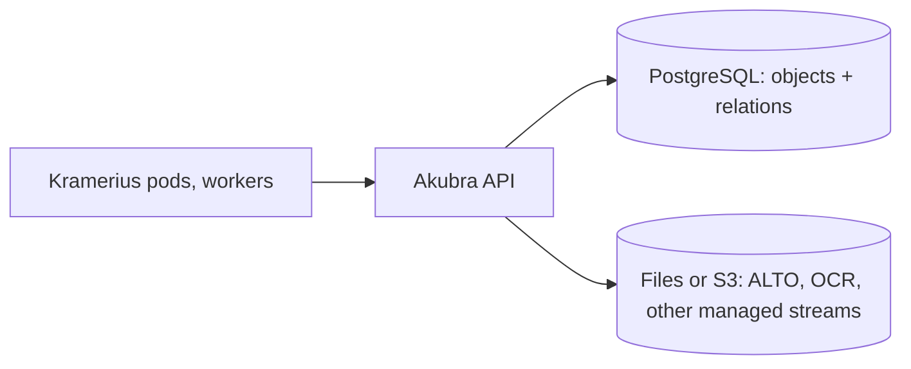

# PH-003 — Compare storage backends for Akubra; the strongest change is FOXML and relations in PostgreSQL, with large datastreams kept on files or S3

> **In one sentence:** of the backends that could replace one-file-per-object on NFS, a relational database is the only one
> that would also fix how Kramerius writes and queries objects (atomic multi-step updates, relations by index instead of a
> Solr round trip), so the option worth testing is FOXML plus relations in PostgreSQL, with ALTO, OCR and other large
> datastreams staying on files or S3; embedded stores such as RocksDB only make sense behind a single repository service.

## Today

- **Objects:** one FOXML file per object and one file per managed datastream, on NFS, through Akubra's `ILowlevelStorage`
  (`AkubraDOManager.java:119–127`, akubra `51d821b`; [run 07](../raw/07-storage-options.md)). Every Kramerius pod, worker
  and plugin JVM opens these files directly; coordination is a per-PID Hazelcast lock.
- **Relations:** parents, children and models live in a separate Solr core, the processing index, kept in sync by Akubra
  on every write. Indexing asks it two to three times per object, p50 36 ms per query, 82 ms of the ~110 ms node build per
  page ([PM-001](../perf-medium/PM-001-read-once-then-prefetch.md), traces 2026-10-27).
- **Writes are not atomic across steps:** RELS-EXT updates save the object twice ([KB-004](../known-bugs/KB-004-relsext-update-writes-object-twice.md)),
  datastream updates delete then create ([run 21](../raw/21-repository-boundary.md)), storage errors are swallowed
  ([BUG-007](../bugs/BUG-007-akubra-swallows-storage-errors.md)), and the object store and the processing index can disagree after
  a failure.
- **Sizes:** FOXML ~8 KB, ALTO ~65 KB, OCR ~3 KB per page (sample of 7,410 objects). MZK holds 78.1 M objects, 98.4% of them
  pages, so roughly 0.64 TB of FOXML, 0.26 TB of OCR and 5.0 TB of ALTO
  ([PH-002](PH-002-group-foxml-and-ocr-per-parent.md)). A database holding FOXML and relations would have ~78 M object rows
  and at least as many relation rows, a few hundred GB before compression; ALTO does not belong in it.

## Options

| Backend | Fit for FOXML (small, structured, often read) | Fit for ALTO / OCR (larger blobs) | Shared by many pods | Atomic multi-object writes | Relations by index | Operations at MZK | Readable without software |
| --- | --- | --- | --- | --- | --- | --- | --- |
| **Files on NFS (today)** | works; one open per read, ~3 ms cold | good | yes | no | no (Solr) | in place | yes |
| **Files, grouped + zstd** ([PH-002](PH-002-group-foxml-and-ocr-per-parent.md)) | one read per parent | good (ALTO per file) | yes, with per-group locks | per group only | no | in place | with zstd |
| **PostgreSQL** (FOXML as `bytea`/`text`, relations as tables) | good: indexed lookup, TOAST compression (lz4) | possible, but terabytes of blobs make backup, replication and vacuum heavy | yes (server) | **yes** | **yes**, SQL with indexes | CNPG already runs here (backups must be fixed first) | via `pg_dump` |
| **RocksDB / LMDB** (embedded key-value) | very good: block compression with dictionaries, fast point reads | good | **no**: one process owns the files; not safe on NFS across pods | within one process | via secondary keys | new; needs a service around it | no |
| **TiKV / FoundationDB** (distributed key-value) | good | good | yes | yes | via keys | heavy new cluster to run | no |
| **S3 / MinIO** ([PH-004](PH-004-s3-blob-store-under-akubra.md)) | per-request latency is high for small objects | good | yes | no | no | new or existing | yes |
| **SeaweedFS** (Haystack-style store for many small files, S3 and filer APIs) | good for many small files | good | yes | no | no | new | partly |
| **OCFL on files or S3** (preservation layout used by Fedora 6) | one directory per object, versioned | good | yes | per object | no | layout change only | **yes**, standard |
| MongoDB GridFS, Cassandra/Scylla | possible | possible | yes | limited | limited | new | no |

Notes:

- **RocksDB and LMDB are libraries, not servers.** Several Kramerius pods, workers and plugin JVMs read and write the
  repository at the same time, so an embedded store needs one repository service in front of it (the remote repository
  boundary that [QOL-002.4](../quality-of-life/QOL-002.4-separate-processes-where-measured.md) defers). Putting their files on NFS
  for several processes is not supported by either.
- **OCFL** does not make reads faster, but it is what Fedora 6 moved to, and it keeps objects readable and versioned without
  the application, which matters for a library's data.
- **A database is only as safe as its backups.** The MZK `kramerius-db` ran for weeks without a working replica and with no
  backup configured (2026-10-28); any database backend starts with fixing that.

## Idea

Keep the storage change in two layers:

1. **Now:** stay on files and do [PH-002](PH-002-group-foxml-and-ocr-per-parent.md) step 1 (per-file zstd) and
   [PM-001](../perf-medium/PM-001-read-once-then-prefetch.md) step A0/A (fewer reads). No new system.
2. **Evaluate PostgreSQL for FOXML and relations** as the alternative to grouped files:
   - a table `object(pid, model, foxml, version, modified)` with FOXML compressed by TOAST, and a table
     `relation(source, predicate, target, position)` replacing the Solr processing index;
   - a RELS-EXT update, a collection change or a delete becomes one transaction across object and relations, which removes the
     failure windows of KB-004, run 21's delete-then-create and the curator sequences of [run 17](../raw/17-curator-write-boundaries.md);
   - the node build's two processing-index queries become indexed SQL lookups;
   - ALTO, OCR and other managed datastreams stay files (or S3), referenced by the object row, so the database stays in tens or
     hundreds of GB instead of terabytes.
3. **Do not** put RocksDB or LMDB under Akubra as shared files; consider them only inside a repository service, if one is ever
   built.

## Expected gain

Nothing here is measured; the numbers are what would be checked first.

| Use case | Today | After (rough) | Confidence | Basis |
| --- | --- | --- | --- | --- |
| node build per page (indexing) | ~110 ms, 82 ms of it processing-index queries | ~10–30 ms if relation lookups take ~1 ms | low | traces 2026-10-27; DB latency not measured |
| FOXML point read | 1–7 ms (NFS file) | ~1 ms (indexed row) | low | not measured |
| failed multi-step writes (KB-004, run 21, run 17) | possible partial state | none (one transaction) | medium | source |
| object store vs processing index drift | possible, needs reconciliation | impossible (same transaction) | medium | design |
| storage for FOXML | ~8 KB per object | ~2 KB with lz4 TOAST | low | not measured on PG; zstd gave 4.4× per file |

## Pros

- Fixes write atomicity and relation queries at the root, not one bug at a time.
- Removes the processing-index Solr core and its sync code.
- PostgreSQL is already operated in the cluster (CNPG) and known to the team.

## Cons and risks

- Biggest change in this review: Akubra's storage and processing index both move, every object is migrated, and every library
  using Akubra is affected.
- Tools that read FOXML files on NFS directly stop working.
- The database becomes the single critical store for objects: replicas, backups with WAL archiving and restore tests are
  mandatory (see the MZK incident above).
- Large datastreams must stay out of the database, so storage remains split in two.

## Alternatives

1. **Files only, improved** ([PH-002](PH-002-group-foxml-and-ocr-per-parent.md)): fewer reads and less space, no new
   system, but no atomic writes and relations still in Solr.
2. **S3 for everything** ([PH-004](PH-004-s3-blob-store-under-akubra.md)): good for blobs, poor for small FOXML reads.
3. **A repository service with RocksDB inside**: fast, but needs the remote repository boundary first.
4. **OCFL layout**: for preservation and portability, combinable with any of the above for the files part.

## Effort

**Size: XL** (see [effort scale](../README.md#effort)).

| Part | Size | Why this size |
| --- | --- | --- |
| Benchmark: PG point reads and relation lookups vs NFS files and Solr | S | throwaway DB, sample of objects |
| PostgreSQL object and relation store behind Akubra's API | L | new storage implementation |
| Replace processing-index callers with the relation table | L | Akubra `pi()`, Kramerius callers |
| Migration of all objects and relations | XL | whole repository, all libraries |
| Database operations: replicas, WAL archive, restore tests | M | chart and operations |

## How we would validate it

1. Load the sample (7,410 objects, relations from `paths.txt` and RELS-EXT) into a throwaway PostgreSQL in the cluster and
   measure, from a pod: point read of one FOXML, the node build's two lookups, and a title's children, against today's NFS
   read (2.7 ms cold) and processing-index query (36 ms p50).
2. If relation lookups are not at least 10× faster than the processing index, drop the relations part; if FOXML reads are
   not faster than a grouped file read, keep FOXML on files.

## Open questions

- How many foster relations does MZK hold on top of the ~78 M own-parent relations?
- Is the processing index used for anything beyond what a relation table would hold (full-text over relations, facets)?
- Would other libraries accept a PostgreSQL dependency for Akubra?
