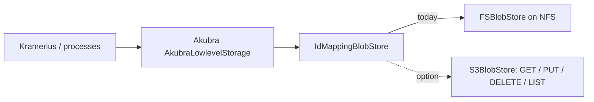

# PH-004 — Put an S3-compatible blob store under Akubra, only after repeated FOXML reads are removed

> **In one sentence:** Akubra already talks to storage through a small `BlobStore` interface, so an S3-compatible backend
> (MinIO, Ceph RGW, a cloud bucket) is a contained change in one place; S3 is not slower than NFS for first or parallel
> reads, but it has no client page cache, and Kramerius today reads the same FOXML dozens to hundreds of times per request,
> which NFS hides and S3 would not, so the repeated reads must be removed first.

## Today

Akubra (`ceskaexpedice/akubra` at `51d821b`, [run 07](../raw/07-storage-options.md)):

- `AkubraDOManager.java:120–125` builds two stores in code, one for object XML (FOXML) and one for managed datastreams:
  `FSBlobStore` (a directory on the filesystem) wrapped in `IdMappingBlobStore` with `HashPathIdMapper` (MD5-based `##/##`
  directories). Only the paths and patterns come from configuration; the store type is fixed.
- The stores come from the Akubra library (`org.akubraproject:akubra-core/fs/map:0.4.0`), a small Fedora-era abstraction:
  open, read, write, `moveTo`, delete, list.
- Replacing an object or datastream is a safe overwrite (`AkubraLowlevelStorage.java:319–396`): write a `new` blob, move the
  original to `old`, move `new` into place, delete `old`. It relies on cheap atomic renames.
- Writes to one PID are serialised with an optional Hazelcast lock (`doWithLock`).
- In production (MZK) both stores are directories on NFS, as at most libraries.

How often a request reads storage matters more than how fast one read is:

- One `/image` or `info.json` request can read the whole FOXML up to **1,061 times** for access logging
  ([kramerius#1339](https://github.com/ceskaexpedice/kramerius/issues/1339), ~5.5 reads per `pid_paths` segment).
- Indexing opens each page's FOXML about 4 times ([PM-001](../perf-medium/PM-001-read-once-then-prefetch.md)).
- The CDK forward path rebuilds a resource graph per request ([PS-001](../perf-simple/PS-001-forward-resource-graph-per-request.md)).

## Idea

1. **Make the store type configurable** in `RepositoryConfiguration` (`fs` or `s3`, per store), so the object store and the
   datastream store can move separately.
2. **Write an `S3BlobStore`** implementing Akubra's `BlobStore`/`Blob`: GET with streaming, PUT, DELETE, HEAD for existence and
   size, paginated LIST for key iteration. There is no maintained S3 store for Akubra 0.4, so this is new code (a few classes
   on top of the AWS SDK or MinIO client).
3. **Drop the rename-based safe overwrite for S3.** A single S3 PUT already replaces an object atomically: readers see the old or
   the new version, never a partial one. So `forceSafeObjectOverwrites` should be off for S3, rather than emulating
   `moveTo` with copy + delete (two extra requests and not atomic).
4. **Keep the Hazelcast per-PID lock** for writers at first; S3 conditional writes (`If-Match`) can replace it later.
5. **Migrate by copy, then switch.** Copy all keys to the bucket with checksums, run the repository read-only during the final
   delta, switch the configuration, keep NFS as rollback until a consistency check passes.

The first useful step is the object store only on a staging copy, because FOXML is small, hot and read often: it shows the
latency cost directly.

## Expected gain

| Use case | Today | After (rough) | Confidence | Basis |
| --- | --- | --- | --- | --- |
| storage operations (capacity, backup, replication) | NFS server, inode limits, file-level backup | bucket capacity, versioning, replication by the store | medium | source + general S3 properties |
| first (cold) read of a FOXML | several NFS round trips: lookup per `##/##` directory level, open, getattr, read | one GET on a kept-alive connection; similar, possibly lower | low | hypothesis, not measured |
| repeated read of the same FOXML | served from the NFS client page cache, microseconds | a full GET every time, milliseconds | medium | how NFS client caching works |
| many parallel reads (indexing with prefetch) | limited by one NFS server | scales with the S3 service | low | hypothesis |
| `/image` with 1,061 FOXML reads today ([#1339](https://github.com/ceskaexpedice/kramerius/issues/1339)) | mostly repeated reads, cheap thanks to the page cache | every read is a GET, seconds in total | medium | #1339 count; repeats lose the cache |

S3 is **not inherently slower than NFS**: both are network storage, and for first reads and parallel reads S3 can match or beat
it. What NFS has and S3 lacks is the client page cache, which today hides Kramerius reading the same FOXML many times per
request. So the speed outcome depends on the read pattern: with the repeated reads removed or cached in Kramerius
(#1339, [PH-001](PH-001-cache-by-invalidation-need.md), [PM-001](../perf-medium/PM-001-read-once-then-prefetch.md)),
S3 can be as fast or faster, especially for parallel indexing; without that, it is slower. The clear gain is operational.

## Pros

- Akubra's `BlobStore` boundary keeps the change inside Akubra; Kramerius code above it does not change.
- No inode or directory-size limits; storage grows by adding capacity to the object store.
- Built-in versioning and replication in most S3 services can replace file-level backups and the rename-based safe overwrite.
- Object store and datastream store can move separately (hybrid).

## Cons and risks

- **Read amplification turns into latency.** Without removing repeated reads first, image opening and indexing get many times
  slower.
- No rename: anything that relies on `moveTo` (safe overwrite, possible maintenance scripts) must be redesigned.
- Listing millions of keys is paginated (1,000 per request), so full scans (processing index rebuild, consistency checks) take
  longer and cost requests.
- Error handling must be strict. Today `AkubraDOManager.write` logs and swallows exceptions when saving an object (see open
  questions); with a network store, transient failures are more common, and silent data loss gets more likely.
- Migration of the whole repository and coordination with other libraries using Akubra.

## Alternatives

1. **Do nothing.** Stay on NFS; storage limits and backups stay as they are.
2. **Per-object zstd on NFS** (note 13, [run 07](../raw/07-storage-options.md)). Saves space without changing the read path's
   latency; inode count stays.
3. **Hybrid:** move only the datastream store (large, rarely rewritten) to S3 and keep FOXML on NFS.
4. **A cache in front of S3** ([PH-001](PH-001-cache-by-invalidation-need.md) tier B for FOXML). Needed in any case if
   reads stay high, but needs invalidation on write.

## Effort

**Size: XL**, set by the repository migration and the coordination it needs (see [effort scale](../README.md#effort)).

| Part | Size | Why this size |
| --- | --- | --- |
| Configurable store type in Akubra | S | `RepositoryConfiguration`, `AkubraDOManager` |
| `S3BlobStore` with streaming, LIST, error mapping | M | new component in Akubra |
| Safe-overwrite switch for S3, strict error propagation | S | `AkubraLowlevelStorage`, `AkubraDOManager.write` |
| Chart and Kramerius configuration, credentials | S | config only |
| Migration tool, checksum verification, cutover and rollback | L | new tooling, staged rollout |
| Prerequisite: remove repeated FOXML reads (#1339, PM-003/002/007) | M–L | several modules |

## How we would validate it

1. **Latency per read, and the repeat share.** From the Akubra method spans in production (workers, since 2026-10-27), take
   p50/p95 per read on today's NFS and the share of reads that repeat a PID already read in the same trace. On staging, replay
   the same reads against the intended S3 service, cold and in parallel.
2. **Reads per request.** With the OTel spans now on Akubra methods (chart 1.3.2), count `AkubraRepositoryImpl.*` calls per
   `/image`, `info.json` and indexed page in production. Multiply by the measured GET latency: if any common request exceeds
   ~200 ms of storage time, fix the read count before going further.
3. **Correctness.** Run Akubra's read/replace/delete/list tests against the S3 store, plus failure injection (connection reset
   during PUT, timeout during GET). No write may be reported as successful when it failed.
4. Drop the idea if the per-read cost times the remaining read count still makes image opening noticeably slower.

## Open questions

- Which S3 service would be used (MinIO, Ceph RGW, a commercial bucket), and where does it sit on the network relative to the
  Kramerius pods?
- `AkubraDOManager.write` catches every exception while saving an object and only logs "Could not replace object in Akubra"
  (`AkubraDOManager.java:245–255`); callers believe the write succeeded. That needs a bug entry and a fix regardless of S3.
- Do backups and other tools read the NFS directories directly? They would need an S3 path too.
- Is anyone else (other libraries, CDK) planning the same, so the `S3BlobStore` can be shared upstream?
