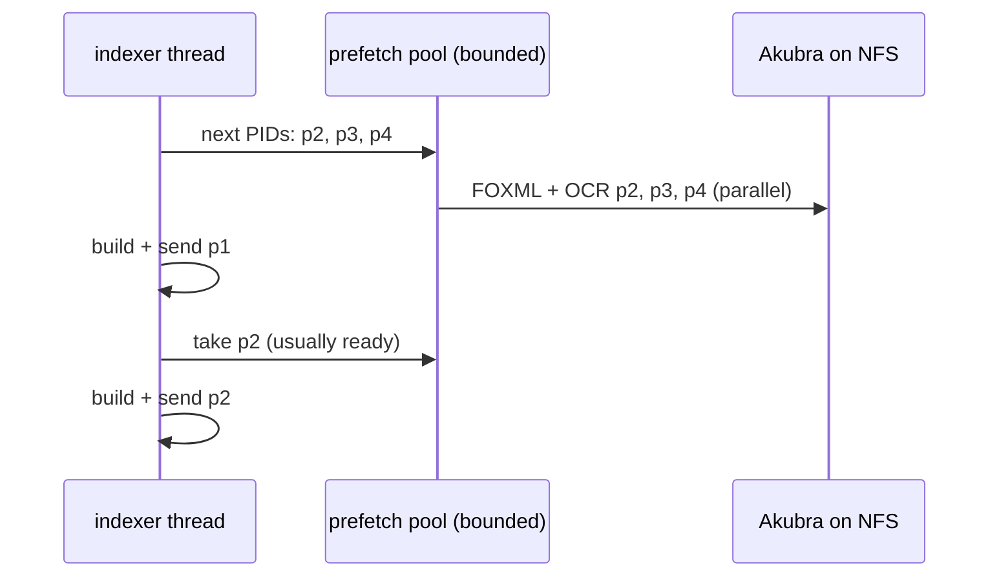

# PM-001 — Read each object's FOXML once during indexing, then prefetch the next pages in parallel

> **In one sentence:** to index one page, the indexer opens and reads the same FOXML file about four times and does every NFS and processing-index read one after another; reading the FOXML once and reusing it removes most of those reads, and a small bounded pool that fetches the next pages while the current one is being built hides much of the NFS wait that remains.

## Today

Kramerius `origin/master` at `560676c`, module `processes/search-index` ([run 05](../raw/05-read-index-capacity.md)).
For each page the indexer does, in this order and on one thread:

| Step | Read | Where |
| --- | --- | --- |
| build node | `exists(pid)`: FOXML stat | `RepositoryNodeManager.java:89` |
| | processing index: parents, model, and children unless the object is a page or track (2–3 Solr queries) | `RepositoryNodeManager.java:93–117` |
| | RELS-EXT: **FOXML read #1** (SAX, picks out the datastream) | `RepositoryNodeManager.java:101` |
| | MODS: **FOXML read #2** (SAX) | `RepositoryNodeManager.java:121` |
| index object | whole FOXML as DOM: **FOXML read #3, full DOM parse** | `Indexer.java:257` |
| | OCR exists, then OCR content (separate datastream file) | `Indexer.java:264–265` |
| | if the OCR ends with a hyphen: next page's OCR exists and content | `Indexer.java:270–282` |
| | IMG_FULL metadata: **FOXML read #4** | `Indexer.java:299` |
| | build Solr document, send it ([PM-004](PM-004-batch-solr-writes-in-indexer.md)) | `Indexer.java:300–320` |

RELS-EXT and MODS are inline in the FOXML, so each of those reads opens the object file and scans it again unless
Akubra caches it (FOXML caching options are in [run 03](../raw/03-cache-matrix.md) and
[PH-001](../perf-hard/PH-001-cache-by-invalidation-need.md)). The node cache (`LRUCache`, 1,024 entries) avoids building a
parent node twice, but not the reads inside one node. The next page's OCR is read once for the hyphen check and again when
that page is indexed.

A maintainer noted on [kramerius#1339](https://github.com/ceskaexpedice/kramerius/issues/1339) that reading one datastream
from Akubra uses a SAX parser that picks out that part, not a full DOM parse. So reads #1, #2 and #4 cost a file open and a
streaming scan over NFS each, not a full parse; only #3 builds a DOM. The NFS round trips are the same either way.

Most libraries keep Akubra on NFS, where every open and every small read is a network round trip. The worker spends that
time waiting with nothing else to do.

**Measured in production** (MZK, 2026-10-27 21:18–22:34 UTC, test indexing jobs; plugin JVMs traced since chart 1.3.2;
a 1% sample of ~50 ms page traces plus every trace over 1 s, so medians are fair and averages lean high). Per page, for
objects without PDF extraction:

| Stage | Time | Reads inside it |
| --- | --- | --- |
| build node (`RepositoryNodeManager.getKrameriusNode`, its own trace) | **p50 109.7 ms** (214 traces, 24 h) | see the split below |
| index object (`Indexer.indexObjectWithCounters`) | p50 41.8 ms, mean 47.1 ms (181 traces) | |
| … Akubra reads in it (datastream content 10.0, `get` 4.2, OCR 3.9, exists 2.7, metadata 0.6 ms self time) | ~21 ms | 2 `getDatastreamContent`, 2 `get`, 2 `datastreamExists`, 2 `getDatastreamMetadata` |
| … one HTTP GET from `SolrInputBuilder` | 12.1 ms | |
| … Solr add | 10.6 ms | [PM-004](PM-004-batch-solr-writes-in-indexer.md) |

The node build alone is about 70% of a page (~160 ms), and with the Akubra reads in the index step, reads and lookups are
about 80%. Building the Solr document takes ~3 ms.

**Inside the node build** (self time per node, 214 nodes):

| Part | Per node | ms per node |
| --- | --- | --- |
| processing-index queries (`/solr/processing/select`, p50 36 ms each) | 2.05 | **82.1** |
| FOXML datastream reads (RELS-EXT, MODS; nested wrapper spans counted once) | ~3 | 28.6 |
| MODS parsing and node assembly | 1 | 13.8 |
| `exists` | 1 | 6.8 |

So the node build is mostly **processing-index round trips**, not FOXML reads. For a page the two queries are
`getOwnedAndFosteredParents` (line 93) and `getModel` (line 103). The model is in RELS-EXT, which the same method has
just read (line 101); the line that took the model from RELS-EXT is commented out (line 102). Reading it from RELS-EXT
again would remove one ~40 ms query per page, about a quarter of page time, if there is no reason it was switched to
the processing index.

## Idea

**A0. Take the page model from RELS-EXT (XS).** Restore `RepositoryNodeManager.java:102` instead of the
`pi().getModel(pid)` query at line 103, or confirm why the processing index is needed there. One processing-index query
less per object. The other per-page query (parents) can be joined into one query per parent for all its children,
see [PM-002](PM-002-coalesce-reads-per-unit-of-work.md) step A.

**A. Read once (S).** Read the FOXML of an object once per indexing pass, parse it once, and take RELS-EXT, MODS and the datastream
metadata (IMG_FULL mimetype, OCR presence) from that one DOM. Keep the OCR of the next page from the hyphen check and reuse it
when that page is indexed. This needs no threads and does not change any result.

**B. Prefetch (M).** When the indexer walks a parent's children (the pages of a volume), it already knows the PIDs of the next
pages. A small bounded pool (e.g. 4 threads, at most K pages or B bytes in flight) reads the FOXML and OCR of the next pages
while the current page is being built and sent. Building and sending stay on one thread in the same order, so field
inheritance from parents and the order of Solr updates do not change.

What stays sequential: building parent nodes before children (fields are inherited), PDF page extraction (`PdfExtractor`
holds one `PDDocument`), and Solr submission.

## Expected gain

| Use case | Today | After (rough) | Confidence | Basis |
| --- | --- | --- | --- | --- |
| processing-index queries per page | 2 (~82 ms) | 1 (step A0); 0 for pages when the parent is already known from the walk (step B) | medium | traces 2026-10-27, source |
| FOXML opens per page | ~4 (1 full DOM parse, the rest SAX scans) | 1 (step A) | high | source |
| OCR reads per page with a hyphen at the end | 2 for the next page | 1 (step A) | high | source |
| NFS wait on the indexer thread | all reads in series | overlapped with build and send (step B) | medium | source |
| indexing wall time | ~160 ms per page, ~80% of it reads and lookups in series | step A removes repeated FOXML reads; step B overlaps the rest | medium | traces 2026-10-27; PDF vs scanned pages 2026-10-28 (~155 vs ~33 ms per page); gain depends on the node-build split |

**Natural experiment, 2026-10-28** ([review 25](../raw/25-pdf-vs-scanned-page-indexing.md)): a scanned monograph of
748 pages indexed at ~155 ms per page, a PDF monograph of 748 pages at ~33 ms per page. PDF pages are indexed from one read
of the PDF, with no per-page object, node build or processing-index lookup, so per-page repository work is about 120 ms of
a normal page, roughly 4/5 of it. Real pages still need their own FOXML and node, so ~33 ms is not reachable; it bounds the
cost of text, document build and the Solr add.

If NFS reads are most of the time per page, step B can give up to several times higher throughput until NFS latency or the
NFS server becomes the limit. If Solr is most of the time, [PM-004](PM-004-batch-solr-writes-in-indexer.md)
matters more. Step A helps in both cases and also reduces load on the NFS server used by `kramerius-public` at the same time.

## Pros

- Step A removes work without changing any behavior or result.
- Step B keeps one writer and the same order, so it does not touch the inheritance logic.
- Less NFS traffic per page also helps image opening and search that run while a reindex is going.

## Cons and risks

- Step B uses more memory (pages in flight) and more NFS connections; the bound must be configurable, and the default should be low.
- Too much parallelism can slow NFS for everyone, including `kramerius-public`. The concurrency sweep must watch public latency, not only indexing speed.
- Prefetched data can be older than the current state if something writes the object while it waits in the buffer.
  A short buffer (a few pages) keeps that window small; it is the same window a single slow read has today.
- `RepositoryNodeManager` and Akubra wrappers are not known to be thread-safe; the pool must only call plain read methods.

## Alternatives

1. **Do nothing.** Each page keeps paying ~4 FOXML reads and all NFS latency in series.
2. **Step A only.** Small and safe; probably the best first step.
3. **Parallelism across titles** (several indexer instances on separate roots). Bigger gain on large jobs, but needs
   deduplication of shared children (foster relations) and separate node caches. Larger change; consider after A and B are measured.
4. **A FOXML cache in Akubra** ([PH-001](../perf-hard/PH-001-cache-by-invalidation-need.md)). Would hide repeated reads for
   every caller, not only indexing, but needs invalidation on write.

## Effort

**Size: M**, set by the prefetch pool and its configuration (see [effort scale](../README.md#effort)).

| Part | Size | Why this size |
| --- | --- | --- |
| A0. Page model from RELS-EXT instead of the processing index | XS | one line in `RepositoryNodeManager`, plus checking why it was changed |
| A. Read FOXML once per object, reuse next page's OCR | S | `RepositoryNodeManager`, `Indexer`, one module |
| B. Bounded prefetch pool for child pages | M | new component, config for threads and limits |
| 0. OpenTelemetry on the indexing worker | done | chart 1.3.2, MZK prod since 2026-10-27 |

## How we would validate it

1. The worker is instrumented (see Today). Index one representative volume-heavy title in staging on the real NFS.
   Record per page: FOXML reads, NFS read time, build time, Solr time.
2. Apply step A. FOXML opens per page should drop to 1, and the resulting index must be identical to the baseline.
3. Apply step B and sweep the pool size (1, 2, 4, 8). Stop where pages/s stops rising, NFS latency rises, or public
   IIIF/search p95 during the job gets worse. Drop step B if NFS reads are under ~30% of time per page after step A.

## Open questions

- Why does `RepositoryNodeManager` ask the processing index for the model instead of reading it from RELS-EXT (line 102 commented out)?
- Why does a processing-index select take 36 ms at p50? The processing core's size and the query shape would tell whether it is the queries or the core.
- Does Akubra already cache FOXML in this deployment (repository cache settings), which would make step A smaller?
- What do NFS read latency and the NFS server's spare capacity look like during a large reindex today?
- Which jobs dominate: whole-model reindex, PID lists after import, or single titles from the admin UI?
