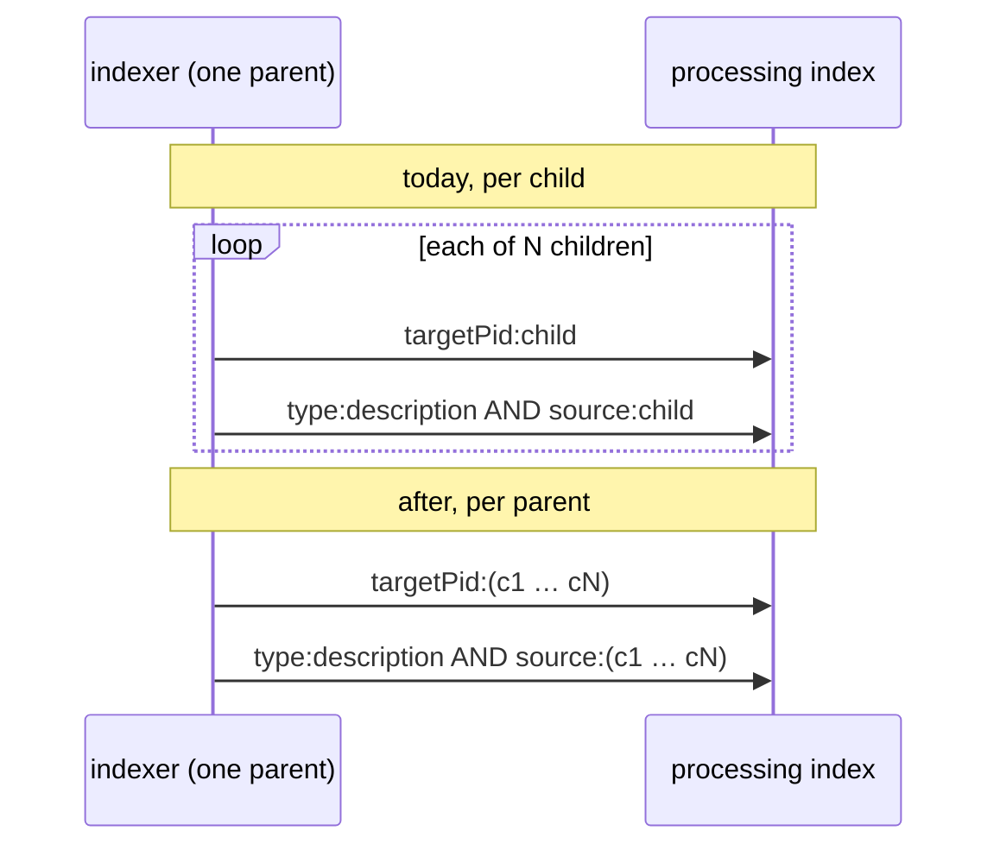

# PM-002 — Collect the reads of one unit of work, join same-shaped queries into one, and wait for the rest on one barrier

> **In one sentence:** Kramerius asks for data one object and one question at a time, so it repeats the same query for one
> object and sends the same-shaped query once per sibling; reading per unit of work (a request, a parent, a batch), joining
> the same-shaped queries into one `field:(a OR b …)` query and starting the reads that do not depend on each other
> together removes most of these round trips, and the largest measured case is the processing-index lookup of every page
> during indexing.

## Today

The same shape shows up in several places. Some are already written up as their own ideas or bugs; this idea names the
pattern they share and adds the cases nobody owns yet.

**The same object queried more than once in one unit of work:**

| Where | What repeats | Evidence | Owned by |
| --- | --- | --- | --- |
| rights check | the requested PID's Solr document, ~3.9 times per `isActionAllowed` | traces, warm | [PS-002](../perf-simple/PS-002-rights-check-refetches-solr-doc.md) |
| indexing, one page | the FOXML, ~4 opens per page; the next page's OCR twice when a page ends with a hyphen | source, traces | [PM-001](PM-001-read-once-then-prefetch.md) step A |
| indexing, node build | the model from the processing index, although RELS-EXT was just read | source, traces | [PM-001](PM-001-read-once-then-prefetch.md) step A0 |
| access-log enrichment | ancestor fields per path occurrence | source ([run 14](../raw/14-targeted-code-audit.md), C2) | [PM-003](PM-003-batched-access-log-writer.md) |

**The same-shaped query sent once per object (N+1):**

| Where | Query sent N times | Evidence | Owned by |
| --- | --- | --- | --- |
| indexing, node build of each child | `targetPid:<child>` (parents) and `type:description AND source:<child>` (model) to the processing index | source, traces | **this idea** |
| access-log enrichment | one Solr read and FOXML per ancestor, per request | traces | [PM-003](PM-003-batched-access-log-writer.md) (one query per batch) |
| indexing, Solr writes | one add per document | source, traces | [PM-004](PM-004-batch-solr-writes-in-indexer.md) |
| folder list | `SELECT … FROM folder_user WHERE folder_uuid = ?` per folder, on its own connection | source ([run 18](../raw/18-folders-source-audit.md)) | [PS-005](../perf-simple/PS-005-folder-list-queries-users-per-folder.md) |

**Independent reads done one after another.** Building one node
(`RepositoryNodeManager.buildKrameriusNodeFromRepository`, lines 87–121 at `560676c`) runs `exists`, the parents query,
RELS-EXT, the model query, the children query (not for pages) and MODS in series. After `exists`, none of them needs the
result of another.

### The largest case: processing-index lookups per child

Kramerius `origin/master` at `560676c`, Akubra `1.7`. The indexer walks a tree from the parent node
(`Indexer.processChildren`, lines 490–530): it takes `parentNode.getPidsOfOwnChildren()` and calls
`nodeManager.getKrameriusNode(childPid)` for each child. Each child node build then asks the processing index on its own:

| Line | Call | Solr query (`ProcessingIndexUtils`) |
| --- | --- | --- |
| `RepositoryNodeManager.java:93` | `pi().getOwnedAndFosteredParents(pid)` | `targetPid:<pid>` (line 235) |
| `RepositoryNodeManager.java:103` | `pi().getModel(pid)` | `type:description AND source:<pid>` (line 202) |
| `RepositoryNodeManager.java:112` | `pi().getOwnedAndFosteredChildren(pid)`, not for pages and tracks | `source:<pid>` (line 218) |

The parent already ran `source:<parent>`, which returned the very relations that make it each child's own parent. Each
child still asks for them again with its own query. The node cache (`LRUCache`, 1,024 entries) avoids building the parent
twice, but it caches nodes, not query results, so it does not help here.

**Measured in production** ([PM-001](PM-001-read-once-then-prefetch.md), MZK, 2026-10-27, test indexing jobs, weighted
for sampling): the node build is p50 ~110 ms of a ~160 ms page; processing-index queries are **2.05 per node, p50 36 ms
each, 82 ms per node**. For a page they are exactly the parents and the model query above.

## Idea

Three rules, applied where they fit:

1. **Read per unit of work, not per call.** Decide what the unit is (one HTTP request, one parent's children in the
   indexer, one batch of log events), keep what was read for that unit in a small map keyed by PID, and drop the map when
   the unit ends. No invalidation is needed because nothing outlives the unit. PS-002 and PM-001 step A are this rule.
2. **Join same-shaped queries.** When the unit has N keys for the same question, send one query for all of them:
   `targetPid:(a OR b OR …)` or `{!terms f=targetPid}a,b,…` in Solr, `WHERE folder_uuid = ANY(?)` or a join in SQL. Split
   long lists into chunks (e.g. 250 keys) so the request and the boolean clause count stay bounded.
3. **Start independent reads together and wait once.** What cannot be joined, because the reads go to different
   systems or ask different questions, is started on a small bounded executor and joined on one barrier
   (`CompletableFuture.allOf`). The wait becomes the slowest read instead of the sum.

### Step A — one processing-index query per parent for its children (S)

When the indexer is about to walk a parent's children, it asks once for all of them, through the existing generic
`pi().iterate(ProcessingIndexQueryParameters, Consumer)`:

- `targetPid:(c1 OR … OR cN)`: every parent relation of every child, own and foster, grouped by `targetPid`;
- `type:description AND source:(c1 OR … OR cN)`: the model of every child (not needed once
  [PM-001](PM-001-read-once-then-prefetch.md) step A0 takes the model from RELS-EXT).

`RepositoryNodeManager` takes these preloaded answers instead of querying per child. The same checks run on the grouped
result as today: more than one own parent still throws, as in `ProcessingIndexUtils.getParentsRelation` (lines 97–116).
The children query (`source:<pid>`) can be joined the same way for children that are not pages or tracks.

No Akubra change: the query goes through an API Kramerius already uses (`ProcessingIndexCheck`,
`SecuredAkubraRepositoryImpl`). Order of building and indexing does not change.

### Step B — one barrier inside a node build and inside a request (M)

For objects that are not reached through a parent walk (indexing one PID, request paths), start the independent reads of
one unit together: in the node build, the parents query, RELS-EXT, MODS and (for non-pages) the children query; in a IIIF
request, whatever reads the rights check and the access log need once PS-002 has removed the repeats. A bounded executor,
shared per JVM, with a low default. Step B is a smaller gain than step A for indexing and should only be built where a
trace shows the reads are in series and of similar length.

## Expected gain

| Use case | Today | After (rough) | Confidence | Basis |
| --- | --- | --- | --- | --- |
| processing-index queries per page, tree indexing | 2 (~82 ms) | 2 per parent, about 0 per page for a volume of hundreds of pages | high for the count, medium for the time | source; traces 2026-10-27 |
| indexing time per page | ~160 ms | about half of it removed, if a joined query for 250 PIDs costs a few times one single query | medium | traces 2026-10-27; joined query cost not measured |
| node build of a single object (step B) | sum of ~6 reads | about the slowest read | low | source only |
| folder list, rights check, access log | N+1 and repeats | see PS-005, PS-002, PM-003 | — | owned there |

**Overlap.** PM-001 step A0 removes the model query (~40 ms) on its own; step A here removes the parents query too, and
together they leave no per-page processing-index query. PM-001 step B (prefetch) hides the remaining FOXML and OCR
waits; it gains less once the processing-index round trips are gone, since they are most of the node build.
[PH-002](../perf-hard/PH-002-group-foxml-and-ocr-per-parent.md) is the same "per parent" unit on the storage side.

## Pros

- Step A is a few classes in one module, uses an existing API and changes no result or order.
- Fewer queries also lowers the load on the processing-index Solr that ingest and the public instance use at the same time.
- One rule explains several measured findings (PS-002, PM-003, PM-004, PM-001), so reviewers can apply it to new
  code instead of finding each case in traces.

## Cons and risks

- A preloaded answer can be older than the processing index if something writes a child's relations during the walk.
  Today each child sees the state at the moment of its own query; after step A it sees the state at the start of its
  parent. Indexing already reads the parent's children list once at the start, so the window is the same.
- A joined query for many PIDs can be slower than expected, or hit `maxBooleanClauses`. Chunking bounds both; the terms
  query parser avoids the clause limit.
- Step B adds threads to code that is single-threaded today. Errors from the barrier must be thrown as the same
  exceptions the serial code throws, or `surviveInconsistentObjects` handling changes.

## Alternatives

1. **Do nothing.** About 40–80 ms of every indexed page stays a processing-index round trip.
2. **Cache processing-index answers longer** ([PH-001](../perf-hard/PH-001-cache-by-invalidation-need.md)). Needs
   invalidation on every relation write; per-unit reads need none.
3. **Only PM-001 step A0.** Removes the model query, keeps the parents query: about half the gain of step A.
4. **Parallel child indexing.** More threads hide the same round trips without removing them, and multiply the load on
   the processing index instead of reducing it.

## Effort

**Size: M**, set by step B's executor and configuration (see [effort scale](../README.md#effort)).

| Part | Size | Why this size |
| --- | --- | --- |
| A. Joined parents and model queries per parent in the indexer | S | `RepositoryNodeManager` and `Indexer.processChildren`, one module, existing Akubra API, no config |
| B. Barrier for independent reads in one node build or request | M | new bounded executor, configuration for its size |
| Rules 1–2 elsewhere | — | done in PS-002, PS-005, PM-003, PM-004 |

Step A does not depend on anything. It is simpler after PM-001 step A0, which drops the model query.

## How we would validate it

- **Joined query cost.** On the production processing index, time `targetPid:(…)` for 1, 50, 250 and 1,000 children of
  a real volume, read-only, against the same number of single queries. Drop step A if the 250-PID query is slower than
  ~25 single ones.
- **Indexing run.** In staging, index the same 748-page scanned monograph as
  [review 25](../raw/25-pdf-vs-scanned-page-indexing.md) before and after step A. Count `/solr/processing/select`
  spans per page and the time per page; the Solr documents must be identical.
- **Step B.** Only after A: compare node build time with and without the barrier for single-PID indexing.

## Open questions

- Why was the model switched from RELS-EXT to the processing index (`RepositoryNodeManager.java:102–103`)? The same
  answer decides whether step A needs the model query at all.
- Are there other N+1 shapes on request paths (search result enrichment, item API children lists)? A trace query that
  counts identical-shape child spans per server span would find them.
