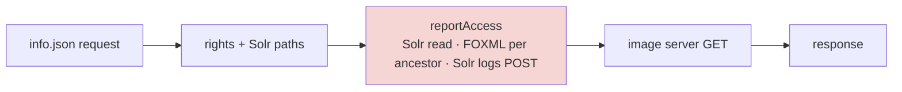
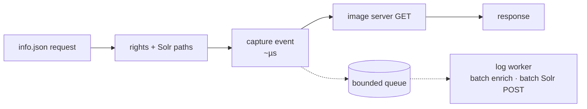

# PM-003 — Move IIIF access logging off the request thread

> **In one sentence:** every IIIF `info.json` request enriches and writes a Solr access-log record *before* it asks the image server for the image, and on the direct route this logging is **half of the request time**. A background writer that batches these records would take that work off the image-opening path.

## Today

Both IIIF `info.json` entry points call `reportAccess` before the image-server GET
([run 02](../raw/02-iiif-logging.md)):

- direct `/search/iiif/{pid}/info.json` (`IiifServlet.java:92–229`)
- forwarded `/search/api/cdk/v7.0/forward/iiif/.../info.json` (`CDKIIIFResource.iiifManifest`, through `AbstractTileResource.reportAccess`)

`SolrStatisticsAccessLogImpl.reportAccess` (lines 109–313) does this synchronously:

1. reads the Solr document,
2. reads and parses FOXML from Akubra (NFS) once per distinct ancestor in the PID path
   (#1339, Sep 2026, already merged, removed the separate DC and MODS reads),
3. builds the Solr update document twice (once only for a `FINE` debug log),
4. POSTs it to the Solr `logs` core.

### Measured in production

**Warm system, 2026-10-28** (3-hour window). The collector keeps every trace with an error or of 1 s or more and 1% of
the rest, so each kept trace is weighted 1 or 100; the weighted request estimate is within ±15% of the NGINX counts.

| Route | Requests (NGINX) | Request p50 | Request p95 | Logging share p50 | Logging share p95 | `reportAccess` p50 |
| --- | ---: | ---: | ---: | ---: | ---: | ---: |
| direct `info.json` | 9,146 | 55 ms | 291 ms | **46%** | **58%** | 31 ms |
| forwarded `info.json` | 8,982 | 214 ms | 400 ms | 15% | 25% | 30 ms |

Logging's share is the same as in the first measurement below; its absolute cost is about ten times smaller once the
system is warm.

**First measurement, 2026-10-27:** method spans were added to the OTel agent that day. These numbers cover **the first
hour after the restart (from 15:10), about 230 logged requests**, with cold caches, unweighted.

**Logging's share of the whole request** (server span vs. `reportAccess` span in the same trace):

| Route | Requests | Request p50 | Request p95 | Logging share p50 | Logging share p95 |
| --- | ---: | ---: | ---: | ---: | ---: |
| direct `info.json` | 96 | 140 ms | 1,335 ms | **50%** | **71%** |
| forwarded `info.json` | 142 | 1,659 ms | 3,311 ms | 16% | 31% |

The `reportAccess` stage itself took a median of ~295 ms and a p95 of ~700 ms.

**Where the logging time goes** (direct children of `SolrStatisticsAccessLogImpl.reportAccess`, first measurement):

| Child | Calls per request | p50 | p95 | Average ms per request |
| --- | ---: | ---: | ---: | ---: |
| FOXML reads (`CoreRepositoryImpl.getAsBytes`) | ~3.1 | 4.2 ms | 90.1 ms | **68** |
| Solr `logs` POST (`SolrUpdateUtils.sendToDest`) | 1 | 18.3 ms | 105.4 ms | **49** |
| Solr document read (HTTP `GET`) | 1 | 5.9 ms | 85.6 ms | 21 |
| MODS identifiers, RELS-EXT model, DC (`LogFields`) | ~4.4 ancestors | ≤ 0.4 ms | ≤ 6.4 ms | 18 |
| `LogRecord.toSolrBatch` (built twice) | 2 | 0.3 ms | 4.3 ms | 6 |

FOXML reads and the logs POST make up about 75% of the time that child spans account for. Their p95
values show the NFS and Solr tails. Some of `reportAccess`'s time is not covered by any child span,
probably DOM parsing in the uninstrumented `LogFields` constructor.

**Correctness, observed at the same time:**

- **B13 is live** ([BUG-012](../bugs/BUG-012-dc-less-ancestor-npe.md)). 108 of 193 `reportAccess` spans (56%) ended with the
  `NullPointerException` at `SolrStatisticsAccessLogImpl.java:243`: an ancestor without Dublin Core makes
  `LogFields.getDCCreators()` return `null` ([bugs](../raw/04-bugs.md)).
  `AggregatedAccessLogs` swallows the exception, so the image request still succeeds.
- **Many statistics records are partial.** `toSolrBatch` ran exactly twice for every request, including
  the failed ones. The `finally` block (line 281) sends whatever the record had collected before the NPE,
  so more than half of the access records may be missing author, publisher and identifier fields.
- The NPE stops enrichment early. Requests that complete enrichment therefore cost *more* than the
  figures above, which underestimate logging time.

## Idea

Split logging into a cheap capture step on the request thread and a background worker:

1. **Capture**: on the request thread, copy the immutable facts (PID, timestamp, user and
   licence decision, HTTP attributes) into a small event. Do not keep servlet objects or
   thread-local state.
2. **Enqueue** the event into a bounded in-memory queue. Return immediately.
3. **Worker**: drain the queue in batches, enrich all events in the batch together (one Solr
   query for all PIDs, each shared ancestor's FOXML read once per batch), and send **one** Solr
   update per batch.

Only moving the POST off the thread would remove about 49 of ~160 ms (first, cold measurement). The FOXML reads are the larger
cost, so the enrichment has to move as well.

## Expected gain

| Use case | Today | After (rough) | Confidence | Basis |
| --- | --- | --- | --- | --- |
| image-open, direct `info.json` | p50 55 ms / p95 291 ms | p50 ~30 ms / p95 ~120–160 ms | medium | weighted method spans, 3 h warm |
| image-open, forwarded `info.json` | p50 214 ms / p95 400 ms | about 15–25% lower | medium | weighted method spans, 3 h warm |
| Solr `logs` load | 1 POST per request | 1 POST per batch | high | source |
| NFS reads for logging | ~3 FOXML reads per request | shared ancestors read once per batch | medium | traces |

The direct-route estimate assumes the queue handoff costs nothing and that the rest of the request
does not get slower once logging leaves it. Most of the forwarded route's time goes elsewhere. That
remaining time needs its own investigation and is not covered by this idea.

The gain overlaps with an ancestor FOXML cache ([cache matrix #3](../raw/03-cache-matrix.md)),
because both remove the same 68 ms of FOXML reads.

## Pros

- Direct image opening roughly halves at the median, and the tail improves more.
- A slow or unavailable `logs` core or NFS tail no longer delays image requests.
- Batching reduces write pressure on Solr and repeated FOXML parsing.
- Fixes several logging bugs in passing: the thread-local leak hypothesis (B4), the unclosed
  Solr response (B12) and the DC-less null iteration (B13).

## Cons and risks

- Log records can be lost on a crash or when the queue overflows, unless we make the queue durable.
- Logs show up later (seconds) instead of immediately.
- Rights and user data must be captured correctly at request time. The worker cannot re-derive them.
- One more component to monitor: queue depth, drops, worker errors.

## Alternatives

1. **Do nothing.** Logging stays at about half of direct `info.json` latency, and more than half of the
   statistics records stay partial because of B13.
2. **Quick fixes only.** Fix B13 (return empty arrays), remove the duplicate `toSolrBatch` and close the
   Solr response (B12). Size XS–S. Fixes the statistics data, but saves only ~6 ms.
3. **Async POST only.** Keep enrichment synchronous and queue just the Solr write. Size M, and saves ~49 ms of ~160.
4. **Cache ancestor FOXML** for enrichment, keeping logging synchronous
   ([cache matrix #3](../raw/03-cache-matrix.md)). Saves up to ~68 ms but needs invalidation on writes.
5. **Ship raw events elsewhere** (e.g. ClickHouse through the existing OTel/Vector pipeline) and enrich them offline.
   Bigger change, and it replaces the Solr `logs` core.
6. **One shared writer for all public pods (preferred shape once the in-pod version works).** Public pods publish the
   captured events to a durable queue (a Redis stream, a PostgreSQL queue table, or Kafka where it exists), and a single
   writer replica batches and enriches them for all pods. One Solr POST per batch of all traffic, one ancestor cache for
   all pods, scaling and restarts independent of the public pods, and a failed writer never affects readers (events wait
   in the queue or are dropped by an explicit policy). Costs: a queue to run, and consumer groups if a second writer
   replica is ever needed. See [QOL-002.4](../quality-of-life/QOL-002.4-separate-processes-where-measured.md).

## Effort

**Size: M.** It adds a new background component (queue and worker) with configuration inside one module,
and log records arrive later than today. No API, schema or storage format changes. It would become **L** if
the `logs` owner requires a durable queue, because that adds new infrastructure.

| Part | Size | Why this size |
| --- | --- | --- |
| [BUG-012](../bugs/BUG-012-dc-less-ancestor-npe.md) fix (ship first, separately) | XS | Two return statements and one test |
| Capture event on the request thread | S | One new class; two call sites change |
| Bounded queue, worker, batch enrichment and batch Solr write | M | New thread, lifecycle and configuration in `shared/common` |
| Shutdown draining, overflow policy, metrics | S | Inside the new component |
| Tests: rights isolation, DC-less objects, overload | S | Unit tests plus one staging load run |

Depends on: the logging durability requirements from the `logs` owner.

## How we would validate it

1. ~~Measure logging's share of `info.json` latency.~~ Done: 50% on the direct route right after a restart, 46% warm
   (2026-10-28, weighted for trace sampling). A daytime peak window would still be useful.
2. Compare the current and async paths under the same load: `info.json` p50/p95/p99, browser image-ready
   time, log completeness and delay, queue depth, Solr and NFS load.
3. Check that the share of complete records rises after the B13 fix: no `reportAccess` error spans, and
   author/publisher fields present in the `logs` core.

## Open questions

- Is losing log records acceptable, and how many? This decides between an in-memory queue and a durable one.
- How fresh do the statistics in the `logs` core need to be?
- Do other endpoints (thumbs, PDF, items) use the same logger and benefit too?
- Which objects lack DC? 56% of requests hitting a DC-less ancestor suggests a whole model (e.g. a
  periodical volume or internal part) is missing it.
