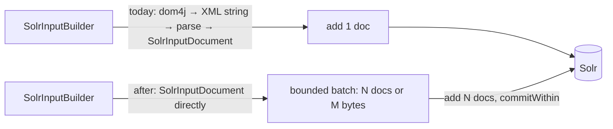

# PM-004 — Send indexed documents to Solr in batches, without the XML round trip and the per-title commit

> **In one sentence:** the main indexer sends every page to Solr as its own HTTP request, after turning the document into XML and parsing it back, and the model-wide reindex forces a hard commit after each title; collecting documents into bounded batches and leaving visibility to `commitWithin` would cut Solr requests by the batch size and remove the commits that make Solr flush segments over and over.

## Today

Kramerius `origin/master` at `560676c`, module `processes/search-index` ([run 05](../raw/05-read-index-capacity.md)):

1. `Indexer.indexObjectWithCounters` builds a dom4j `Document` with `SolrInputBuilder`, turns it into a string with
   `asXML()` and calls `SolrIndexAccess.indexFromXmlString(str, false)` (`Indexer.java:300–306`).
2. `indexFromXmlString` turns the string into bytes (`xmlString.getBytes()`, platform charset; harmless in practice because
   `PluginJvmLauncher` starts every job with `-Dfile.encoding=UTF-8`), parses it again with `SAXReader`, builds a `SolrInputDocument`, and calls `solrClient.add(collection, doc, 15000)`:
   **one HTTP request per document** (`SolrIndexAccess.java:109–122`).
3. If parsing fails, usually because the OCR has a character that XML does not allow, the indexer catches
   `DocumentException` and **indexes the page again with empty OCR** (`Indexer.java:307–319`). The page's full text is lost
   from search, only because of the XML step.
4. The model-wide reindex (`NewIndexerProcessIndexModel.java:123`) calls `indexByObjectPid(pid, …, commitAfterPid = true)`, so
   after every top-level title the indexer sends an explicit `commit` (`Indexer.java:145–147`). The PID-list process
   commits once at the end (`solrSearch.commitAfterBatch`, default true).
5. Deletes go one by one, and each `deleteById` commits (`SolrIndexAccess.java:145–173`).

The CDK and copy migration feeders already send multi-document batches (default 20, `RequestConfig.java:10`); this idea
does not touch them.

**Measured in production** (MZK, 2026-10-27 21:18–22:34 UTC, test indexing jobs, plugin JVMs traced since chart 1.3.2).
The collector keeps every trace over 1 s or with an error, plus 1% of the rest, so the ~50 ms page traces are a 1% sample
(181 objects without PDF extraction) and averages lean slightly high; medians are not biased by this.

| Stage, per page (object without PDF extraction) | Time | Basis |
| --- | --- | --- |
| node build (`RepositoryNodeManager.getKrameriusNode`, its own trace) | p50 111.5 ms | 177 traces |
| index step (`Indexer.indexObjectWithCounters`) | p50 41.8 ms, mean 47.1 ms | 181 traces |
| … of which Akubra reads (datastream content, `get`, exists, metadata, OCR) | ~21 ms | self time per stage |
| … of which one HTTP GET from `SolrInputBuilder.processObjectFromRepository` | 12.1 ms | target not yet identified |
| … of which **Solr add** (HTTP POST 9.8 ms + XML round trip 0.8 ms) | **10.6 ms** | 1 add per page |
| … of which building the Solr document | ~3 ms | |
| **hard commit** (`SolrIndexAccess.commit`) | **5.8 s** (one traced) | per title in model-wide reindex |
| PDF objects (`Indexer.indexPagesFromPdf`) | p50 12.4 s per PDF, ~415 Solr adds each | 5 traces |

So the per-page Solr add is about 7% of a page (~160 ms). The commit is per title: 5.8 s spread over a 100-page title
is ~58 ms per page, more than the add itself.

## Idea

1. **Build `SolrInputDocument` directly.** `SolrInputBuilder` already knows every field name and value. Fill a
   `SolrInputDocument` instead of a dom4j document, or convert dom4j to it in memory without serialising. This removes the
   string and parse step and the "reindex without OCR" fallback ([BUG-013](../bugs/BUG-013-ocr-dropped-on-invalid-xml-char.md)). Control characters can be stripped from OCR
   in one place before they reach Solr.
2. **Batch the adds.** Collect finished documents in a per-job buffer and flush when it reaches N documents or M bytes
   (OCR makes sizes vary a lot), when a title ends, and when the job ends. Keep one writer thread so the order of updates for the
   same PID is unchanged.
3. **Stop the per-title hard commit in the model-wide reindex.** Rely on `commitWithin` (already 15 s on every add) for
   visibility, and send one explicit commit at the end of the job. Make it configurable, like `solrSearch.commitAfterBatch`
   already is for the PID-list process.
4. **Batch deletes** the same way, with one commit at the end.

If a batch fails, Solr does not say which document was rejected. On failure, resend that batch one document at a time to find
the bad one, log it and go on. That is what happens today, just in fewer requests.

## Expected gain

| Use case | Today | After (rough) | Confidence | Basis |
| --- | --- | --- | --- | --- |
| Solr update requests per job | 1 per page | 1 per N pages (e.g. N = 100 → 100× fewer) | high | source |
| explicit commits in a model-wide reindex | 1 per title (thousands per job) | 1 per job | high | source |
| indexing wall time, batching adds (step 2) | Solr add 10.6 ms of ~160 ms per page | at most ~7% faster | medium | traces 2026-10-27 |
| indexing wall time, no per-title commit (step 3) | 5.8 s per title | that much less per title (~58 ms per page on a 100-page title) | medium | one traced commit; commit cost grows with index size and load |
| pages indexed without OCR because of XML errors | unknown | 0 | medium | source |
| search latency during reindex | ? | likely better (fewer segment flushes) | low | hypothesis |

The traces answer the question this paragraph used to leave open: most of a page is the node build and Akubra reads, not
Solr. [PM-001](PM-001-read-once-then-prefetch.md) has the larger wall-time lever; this idea's value is
the per-title commit (step 3), Solr load, and the OCR correctness fix (step 1).

## Pros

- Fewer Solr requests and far fewer hard commits: less Solr CPU and segment churn, which also helps search running at the same time.
- Fixes a correctness problem: pages losing all OCR on one invalid character ([BUG-013](../bugs/BUG-013-ocr-dropped-on-invalid-xml-char.md)).
- One module, no API, schema or storage change.

## Cons and risks

- **Visibility.** Without the per-title commit, a title becomes searchable up to `commitWithin` (15 s) later. Curators who
  reindex one title and check it right away may notice. The single-PID path from the admin UI can keep its explicit commit.
- Batch errors need the one-by-one fallback, or one bad document fails the whole batch.
- Memory: a batch of OCR-heavy pages can be large; the byte limit is needed, not only the count limit.
- If the job crashes, up to one batch of documents is not sent. Indexing is idempotent, so a rerun fixes it, but the progress
  counter must count only documents Solr has accepted.

## Alternatives

1. **Do nothing.** Indexing keeps one request per page and thousands of commits per model-wide job; OCR with an invalid
   character keeps disappearing from search.
2. **Only drop the per-title commit** (step 3). XS, one argument plus a config flag. Probably the cheapest win, and a good first step.
3. **Only remove the XML round trip** (step 1). Fixes the OCR loss without changing request patterns.
4. **`ConcurrentUpdateSolrClient`** (SolrJ's background batching client). Gives batching almost for free, but reports errors
   asynchronously, so failures can no longer be tied to a PID without extra work.

## Effort

**Size: M**, set by the new batch buffer and the change in when documents become visible (see [effort scale](../README.md#effort)).

| Part | Size | Why this size |
| --- | --- | --- |
| 3. Configurable per-title commit in the model-wide reindex | XS | one argument and one config key |
| 1. `SolrInputDocument` without XML round trip | S | `SolrInputBuilder`, `Indexer`, `SolrIndexAccess` |
| 2. Bounded batch buffer with one-by-one fallback | M | new component and config; visibility timing changes |
| 4. Batched deletes | S | `SolrIndexAccess` |
| 0. OpenTelemetry on the indexing worker (prerequisite for measuring) | done | chart 1.3.2 (`JAVA_TOOL_OPTIONS` reaches plugin JVMs), on in MZK prod since 2026-10-27 |

## How we would validate it

1. The agent and method spans are in place (see Today). Run one representative model-wide reindex in staging as a baseline:
   pages/s, share of time per stage, Solr update and commit count, Solr CPU and merges, and search p95 during the job.
2. Apply step 3 alone, then steps 1–2, on the same input. Compare pages/s and Solr load. Check correctness by comparing the
   resulting index with the baseline index (same documents and fields, and `text_ocr` present for the pages that used to lose it).
3. Drop step 2 if Solr add plus commit is under ~10% of job time in the baseline; keep steps 1 and 3 for correctness and Solr load.
   The first production traces put the add alone at ~7%, so step 2 is likely to be dropped unless the staging baseline
   (with commits counted per title) says otherwise.

## Open questions

- Which reindex jobs run most often in production (model-wide, PID list, single title from the admin UI), and how long do they take?
- Is anyone relying on a title being searchable immediately after the model-wide reindex has passed it?
- How many pages are indexed today without OCR because of the XML fallback? A count of the "Reindexing without text_ocr"
  message in worker logs would answer it.
