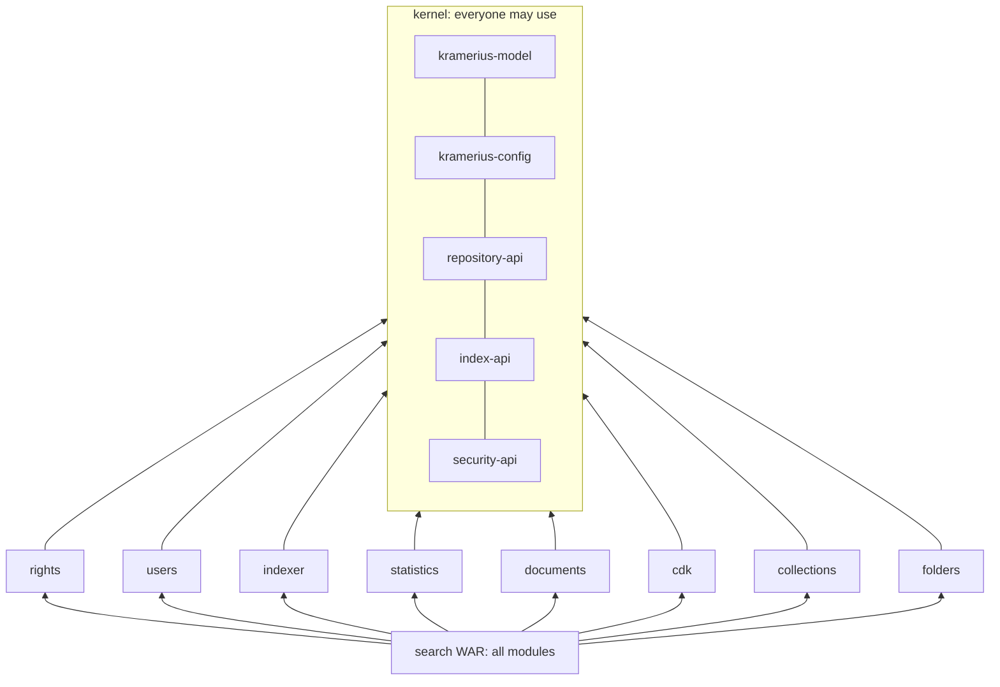

# QOL-002.2 — Level 2: cut shared:common into a small kernel and feature modules, still built into one Kramerius image

> **In one sentence:** the second level of [QOL-002](QOL-002-modularize-in-four-levels.md): after level 1 has narrowed
> the interfaces and broken the cycles, split the 509-class `shared:common` into five kernel modules that everything may use
> and feature modules that each serve one side, move each feature's REST resources and plugins next to it, and keep
> assembling all of them into the one `search` WAR, so nothing changes for deployment yet.

## Today

`shared:common` has 509 main classes; every web pod and plugin JVM loads all of it and its libraries. Which parts are
really common is measured in [QOL-002, Q1](QOL-002-modularize-in-four-levels.md#q1-what-is-actually-common). `folders` is
the only feature already in its own Gradle module (it depends only on `shared:common`). Plugins import mostly `utils` (80
files), index write (`solr` 19, `fedora` 18, `dochub` 12), `statistics` 18 and `service` 18.

## Questions and answers

### Q1. Which modules form the kernel?

**Answer:** five, each small and API-only where possible:

| Kernel module | From | Contains |
| --- | --- | --- |
| `kramerius-model` | root package, `relation` | `ObjectPidsPath`, `ObjectModelsPath`, `KrameriusModels`, `Constants`, relation model |
| `kramerius-config` | `utils` after level 1 | configuration (`KConfiguration`) and utilities with no Kramerius imports |
| `repository-api` | level 1 | `RepositoryReader`, `RepositoryWriter` |
| `index-api` | `SolrAccess`, level 1 | index reader, `IndexWriter` interface |
| `security-api` | `security` (contract part) | `User`, `Role`, `RightsEvaluator`, secured actions |

**Why:** these are what the public API, admin API, CDK API, search WAR and plugins all import (QOL-002 Q1); keeping the
kernel small is what lets an image or a plugin leave everything else out.

### Q2. Which feature modules?

| Feature module | From `shared:common` | Plus | Used by |
| --- | --- | --- | --- |
| `rights` | `security` implementation: criteria, licences, rights DB (most of 109 classes) | rights admin resources | public, curator (evaluation); curator (administration) |
| `users` | `users`, `database` | Keycloak / Shibboleth filters (`security:*`) | web roles |
| `indexer` | `solr`, `fedora`, `dochub` | `processes:search-index`, index plugins | plugins |
| `statistics` | `statistics` (59) | statistics resources, `nkp-logs`, `statistics-p` plugins | public (capture), plugins (reports) |
| `documents` | `pdf`, `printing`, `document`, `imaging`, `audio`, `cz.knav.pdf` (101) | PDF resources, `genpdf`, `genebook`, `gentext` plugins | public, public worker |
| `cdk` | `cz.inovatika.cdk`, `cdk` | `apiNew/cdk` resources, CDK plugins | CDK |
| `collections` | `virtualcollections` (if still used) | `CollectionsResource`, collection plugins | curator |
| `folders` | already a module | — | public |
| `uiconfig`, `workmode`, `process-client` | `uiconfig`, `workmode`, `processes` | their resources | curator writes, public reads |

`monitoring` is not moved; [QOL-001](QOL-001-otel-in-images-replace-monitor-core.md) replaces it.

### Q3. Do the REST resources move too?

| Option | For | Against |
| --- | --- | --- |
| Keep all resources in `rest` | smaller change | level 3 cannot leave a feature's endpoints out of an image |
| **Move each feature's resources into its module** | level 3 becomes choosing modules | larger move now |

**Answer:** move them, with each feature module providing its own Guice module. `rest` keeps the shared JAX-RS setup,
exception mappers and the core resources.

### Q4. Does the image change?

**Answer:** no. The `search` WAR depends on all modules, so the image has the same content. Only plugins change: each
plugin depends on the kernel and the features it uses, and its JVM loads less.

## Proposal

1. Create the five kernel modules from level 1's interfaces and cleaned packages.
2. Move feature code out of `shared:common` one feature at a time, starting with the ones with one consumer
   (`documents`, `cdk`, `indexer`), each with its resources and plugins.
3. Remove the `//TODO: Delete` and `//TODO: Move` process modules from the `search` WAR's dependencies
   (`search/build.gradle:55–60`) where they are not used at runtime.
4. Architecture tests per module: a feature may depend on the kernel and on listed features only.

## What gets easier

| Who | Today | After | Basis |
| --- | --- | --- | --- |
| plugin authors | a plugin loads all 509 classes and their libraries | the kernel plus its features | build |
| maintainers | upgrading a library (e.g. iText, PDFBox) touches the shared module everyone uses | only the module that uses it | build |
| new features | go into `shared:common` or `rest` | a new module with its resources, tables and plugins | design |

No deployment change, no behavior change.

## Costs and risks

- A large Gradle move; best done feature by feature, each merged on its own.
- Needs upstream agreement on module names and boundaries, or it becomes a fork.

## Alternatives

1. **Do nothing.** Level 3 can only switch roles at runtime; images keep all code.
2. **Split by layer** (`api`, `impl`, `rest`). Rejected in [QOL-002, Q3](QOL-002-modularize-in-four-levels.md#q3-modules-by-layer-or-by-feature).

## Effort

**Size: L**, set by changes across several modules.

| Part | Size | Why this size |
| --- | --- | --- |
| Kernel modules | M | from level 1's interfaces |
| Each feature module with its resources | S–M each | about nine features |
| Plugin dependencies and `search/build.gradle` | S | build files |
| Module architecture tests | S | rules |

## How we know it worked

- `shared:common` is gone or holds only what is truly shared.
- A plugin's runtime classpath (e.g. `genpdf`) lists only the kernel and `documents`.
- The `search` WAR's content is the same as before the split (class list diff), and the test suite passes.

## Open questions

- Is `virtualcollections` still used through reflection or configuration? It has no imports outside `shared:common`.
- Should `rights` evaluation and rights administration be one module or two?
