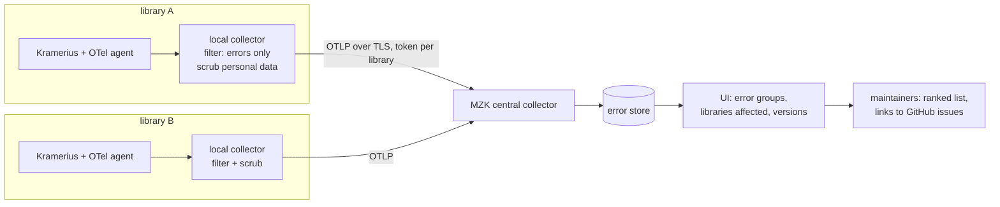

# QOL-003 — Run a central, MZK-managed error-tracking service that Kramerius libraries can join, grouping the same bug across installations

> **In one sentence:** many of this review's bugs were found by reading MZK's log files by hand, and the same code fails
> the same way at every other library where nobody is looking; a central error-tracking service run by MZK, fed by each
> library's OpenTelemetry collector with personal data stripped at the source, would group each error across
> installations, count how many libraries it hits, and give the maintainers a ranked list of real bugs.

## Today

- Each library sees only its own logs, if anyone reads them. Errors reach the maintainers (`ceskaexpedice`) when a library
  opens a GitHub issue by hand.
- This review found several defects only by sweeping MZK's Tomcat logs inside the pods, with masking scripts:
  [BUG-015](../bugs/BUG-015-pdf-font-scan-per-request.md) (831 `ConcurrentModificationException`s in 7 days),
  [BUG-016](../bugs/BUG-016-export-fails-on-file-referenced-streams.md) (110 export errors),
  [BUG-017](../bugs/BUG-017-search-solr-400-returned-as-500.md) and
  [BUG-023](../bugs/BUG-023-search-default-field-does-not-exist.md) (14,342 Solr errors, mostly one cause),
  [QOL-006](QOL-006-web-xml-declares-deleted-servlets.md) and
  [BUG-026](../bugs/BUG-026-iiif-500-for-objects-without-tiles.md). Error spans in traces found
  [BUG-012](../bugs/BUG-012-dc-less-ancestor-npe.md) (36,617 NPEs a day).
- Several of these come from shipped code or shipped configuration (`df=text`, `web.xml`, the font scan), so every
  library on the same version very likely has them. Nobody can tell, because nobody sees more than one installation.
- [QOL-001](QOL-001-otel-in-images-replace-monitor-core.md) puts an OpenTelemetry agent and collector at each library,
  with logs and exceptions as structured data and a `kramerius.library` attribute. That is the transport this idea needs.

## Idea

A shared service, run by MZK, that receives **only errors** from participating libraries and groups them.

1. **What leaves a library:** error spans with their exception events (type, stack trace), and log records at `SEVERE` /
   `ERROR` with stack traces. Nothing else: no successful requests, no access logs, no statistics.
2. **Scrubbing at the source**, in the library's own collector, before anything is sent (`filter`, `attributes`,
   `transform` or `redaction` processors):
   - an **allow-list** of attributes (service, route template, HTTP method and status, exception type, code location,
     Kramerius and component versions, library code);
   - drop user identifiers, IP addresses, query strings, request headers and bodies;
   - mask exception and log **messages** the way this review's scripts did (quoted text, numbers, e-mails, URLs, UUIDs);
     PIDs can stay or be masked, by the library's choice.
3. **Grouping** by fingerprint: exception type plus the top in-app stack frames (Kramerius, Akubra, process-platform
   packages), ignoring line numbers that change between versions. Each group shows first and last seen, count, **number of
   libraries affected**, versions, and a masked example.
4. **Outputs:** a weekly digest to the maintainers and participating libraries (new groups, groups spreading to more
   libraries, regressions after a release), a link from each group to its GitHub issue, and per-library views so each
   library sees its own errors.
5. **Access:** each library sees its own data; the maintainers and MZK see aggregated groups across libraries.

**How to build it.** Two realistic options:

- **OTel-native (recommended):** a central OpenTelemetry collector with token authentication per library, a ClickHouse
  store and HyperDX (the same ClickStack MZK already runs), plus grouping as a ClickHouse view or a small job that
  computes fingerprints. Libraries need nothing beyond QOL-001's collector and a second exporter.
- **Sentry-compatible:** self-hosted Sentry, or the lighter GlitchTip, which gives grouping, digests and issue links out
  of the box but needs the Sentry Java SDK in Kramerius (a second agent next to OTel). Self-hosted Sentry is heavy
  (Kafka, ClickHouse, PostgreSQL, Redis, many services).

## Expected gain

| Use case | Today | After (rough) | Confidence | Basis |
| --- | --- | --- | --- | --- |
| finding bugs | one library's logs read by hand, occasionally | every participating library's errors grouped continuously | high | this review's method |
| prioritizing bugs | by who reports first | by number of libraries and occurrences | medium | design |
| releases | regressions noticed by users | new error groups after a version change flagged in the digest | medium | design |

## Pros

- Turns isolated log noise into a shared, ranked bug list for the whole Kramerius community.
- Libraries without operations staff get bug detection for free.
- Builds on QOL-001's collector; a library joins by adding one exporter and a token.
- MZK already runs the needed stack and has the experience from this review.

## Cons and risks

- **Personal data and agreements:** even scrubbed, errors leave the library. Needs a data-processing agreement between MZK
  and each library, a published scrubbing configuration, retention limits, and a way for a library to leave and have its
  data deleted.
- **Security data:** stack traces can reveal vulnerable code paths of a specific installation; access to cross-library
  views must be limited, and security-relevant groups handled privately.
- **Operating cost for MZK:** a service other institutions depend on, with availability expectations.
- **Scrubbing must be right before anything is sent**; a misconfigured library collector could leak data. Ship the
  scrubbing config as part of QOL-001's defaults and test it.
- Grouping quality: fingerprints that are too fine split one bug into many groups; too coarse merges different bugs.

## Alternatives

1. **Do nothing.** Each library keeps its own logs; bugs surface when someone reports them.
2. **Hosted Sentry (SaaS).** Least operating work; data leaves to a third party (EU region possible), costs per event, and
   still needs the Sentry SDK and agreements.
3. **Periodic log sweeps shared by hand** (libraries run a masking script like this review's and send the counts). Cheap,
   no infrastructure, but manual and irregular.
4. **Each library runs its own error tracking.** Helps each library, but nobody sees that a bug hits ten installations.

## Effort

**Size: XL.** Several systems and institutions: a shared MZK service, per-library configuration, and agreements.

| Part | Size | Why this size |
| --- | --- | --- |
| Central collector with per-library tokens, TLS, ClickHouse tables with retention | M | MZK infrastructure, reusing the ClickStack setup |
| Fingerprinting and error-group views, weekly digest | M | A view or small job plus dashboards |
| Scrubbing and errors-only pipeline as a shipped collector config | S | Part of QOL-001's defaults; must be tested |
| Agreements, documentation, onboarding of pilot libraries | M | Non-technical but blocking |

Depends on [QOL-001](QOL-001-otel-in-images-replace-monitor-core.md) (the agent and collector at each library). Stage 0
(CDK and MZK) needs only the central part and MZK's existing OTel setup.

## How we would validate it

0. **Stage 0, the CDK and MZK.** Start with sources MZK already operates: the CDK (in MZK's cluster, `prod-core`) and MZK's
   own Kramerius. No other institution's data and no new agreement are needed. The CDK forwards requests to every
   library, so its errors (failed forwards, failed `forward/user` lookups, source-library 5xx and timeouts, harvest
   errors) already show **per-library failures** grouped by source library, before any library installs anything.
   Success: the first error groups and the weekly digest work on real data, and the scrubbing config is reviewed once.
1. Pilot with one or two more libraries for a month, errors only, with the scrubbing config reviewed by each library.
2. Success: at least a few error groups that occur at more than one library and were not yet reported upstream, and no
   personal data found in a manual audit of a sample of received events.
3. Drop or shrink to alternative 3 if libraries cannot agree on data sharing.

## Open questions

- Which libraries would join a pilot, and who signs the data agreement on each side?
- Should the maintainers (`ceskaexpedice`, Inovatika) co-own the service, so the bug list feeds their issue tracker
  directly?
- How long should error groups and examples be kept?
- Decided: the CDK is the first source (stage 0 under validation). Which CDK errors identify the source library reliably
  (the library code is part of the forward path and the CDK configuration)?
