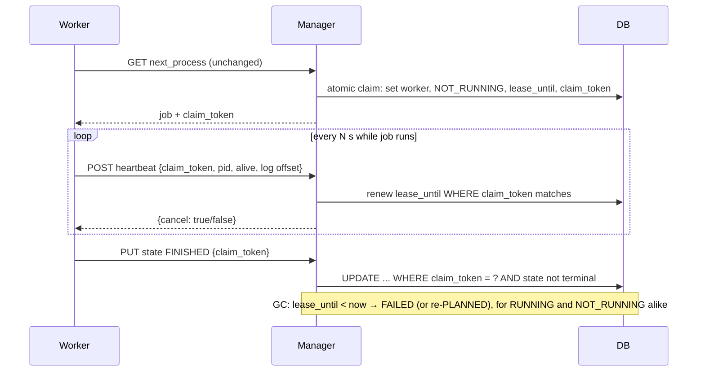

# QOL-004 — Let workers initiate all manager–worker traffic, using a heartbeat lease instead of manager probes

> **In one sentence:** workers already pull their work, but the manager still calls *into* each worker to check liveness, kill processes and read logs; if the worker reported everything over a periodic heartbeat that also renews a lease, the manager would never need to reach a worker, and a network hiccup would stop failing jobs that are still running.

## Today

The direction is mixed ([run 06](../raw/06-process-communication.md), [processing boundary](../raw/22-processing-boundary.md)):

| Traffic | Direction | Source |
| --- | --- | --- |
| Register node and plugins | worker → manager | `ForWorkerEndpoint.java:54–77` |
| Ask for next job | worker → manager (poll, 1 s idle sleep by default) | `WorkerLoop.java:42–106`, `ForWorkerEndpoint.java:78–112` |
| PID, RUNNING, terminal state | plugin child JVM → manager | `PluginStarter.java:60–110` |
| Liveness check of RUNNING jobs | **manager → worker** `GET /manager/info` | `GCTask.java:47–70` |
| Kill | **manager → worker** `DELETE /manager/{pid}/kill` | `WorkerClient.java:58–70` |
| Logs | **manager → worker** `GET /manager/{processId}/log/...`, proxied | `WorkerClient.java:73–135` |
| Working-directory cleanup | **manager → worker** `DELETE /manager/{processId}/directory` | `WorkerClient.java:43–56` |

So the note that the communication is "flipped" is only half right. Work acquisition already goes the right way.
The control and observation half is reversed: the manager must know every worker's URL (`WorkerClient.getWorkerBaseUrl`,
looked up from the registered node), must be able to reach it, and treats "cannot reach" as "dead".

This causes four confirmed source-level defects (none measured in production yet):

- **B8:** `GCTask` marks a RUNNING job FAILED on *any* exception from the worker probe, so a timeout or a worker pod restart fails a job whose child JVM may still be running.
- **B7:** a claimed job sits in NOT_RUNNING forever if the claim response is lost or the worker dies before RUNNING. Nothing reclaims it, because GC only looks at RUNNING.
- **B25:** state updates are `UPDATE ... WHERE process_id = ?` with no condition, so a late FINISHED from a child that GC already failed overwrites FAILED (or the reverse).
- **B16:** the log proxy leaks the HTTP response and turns a worker 404 into an empty 200.

Logs live only on the worker, so they are gone when a worker pod is replaced.

## Idea

Make the worker the only side that opens connections, and make the manager judge liveness by **lease expiry** instead of probing.

1. **Atomic claim with a token and a lease.** One conditional `UPDATE ... WHERE state = 'PLANNED' ... RETURNING` (or `SELECT ... FOR UPDATE SKIP LOCKED`) replaces the `synchronized` read-then-two-writes. This fixes B7 and makes several manager replicas safe.
2. **Heartbeat renews the lease.** The worker reports PID and child liveness every N seconds. GC fails (or re-plans) any job whose lease ran out, in RUNNING *or* NOT_RUNNING. No probe, so no B8: a short network outage only delays the next heartbeat, and the lease is sized to absorb it.
3. **Kill as a heartbeat answer.** The manager sets `cancel_requested` in the DB, and the next heartbeat response tells the worker to kill the child. Cancellation is acknowledged by the worker's terminal report (KILLED).
4. **Every state report carries the claim token** and only legal transitions are accepted (no move out of a terminal state). This closes B25 and fences off a worker that lost its lease.
5. **Logs leave the worker.** Two options: the worker uploads log chunks with the heartbeat into manager storage, or the child writes to stdout and the existing Vector → ClickHouse pipeline collects them (`otel_logs`). Either way the `/manager/*/log` proxy (B16) and the worker's HTTP endpoint can go. Working-directory cleanup becomes the worker's job after the terminal report.

The worker no longer needs an inbound HTTP server or a stable address. That matters in Kubernetes, where workers are StatefulSet pods behind a headless service today.

## Expected gain

| Use case | Today | After (rough) | Confidence | Basis |
| --- | --- | --- | --- | --- |
| indexing, ingest (long jobs) | a probe timeout or worker restart fails a still-running job (B8); late report can flip the state (B25) | a job fails only after the lease expires; terminal state cannot be overwritten | medium | source |
| admin (process list) | stranded NOT_RUNNING jobs need manual cleanup (B7) | reclaimed automatically after lease expiry | medium | source |
| admin (logs) | logs lost with the worker pod; proxy leaks responses (B16) | logs survive worker replacement | medium | source |
| dispatch latency | ≤ 1 s idle poll | unchanged | high | source |

This is a correctness and operability idea, not a speed one. No incidence of B7/B8/B25 has been measured in production yet.
A message broker was considered in run 06 and does not fix any of these on its own: the claim, lease and fencing rules are needed with any transport.

## Pros

- Fixes B7, B8, B25 and B16 with one consistent model instead of four separate patches.
- Workers need no inbound port and no registered URL, so scaling or rescheduling pods needs no address bookkeeping.
- Safe with more than one manager replica, because the claim is done in the DB.
- Stays on plain REST and the existing DB; no new infrastructure.

## Cons and risks

- REST contract change between manager, worker and plugin starter: they must be upgraded together, or the manager must accept both old and new reports for a release.
- Kill latency becomes up to one heartbeat interval instead of immediate.
- The lease length is a trade-off: too short and slow GC pauses fail healthy jobs, too long and dead workers block jobs for a while.
- Re-planning an expired job is only safe for plugins whose side effects are idempotent. Failing it, as today, is the safe default.
- Heartbeat traffic is N requests per running job per interval. It is small compared with idle polling, but should be measured.

## Alternatives

1. **Do nothing.** Long indexing jobs can be failed by a transient network or pod event, stranded claims need manual cleanup, and logs vanish with worker pods. How often this happens is unknown.
2. **Patch each bug in place.** Guarded state `UPDATE` (B25), a NOT_RUNNING timeout in GC (B7), retry the probe before failing (B8), close the proxy response (B16). This is size S per bug and a good first step. But B8 can only be softened, not fixed, while liveness depends on the manager reaching the worker.
3. **Message broker** (run 06). Reduces idle polling, but adds operations and still needs the same claim, lease and fencing rules. Only worth it if polling load is shown to matter.
4. **Long polling for `next_process`.** Lowers idle requests. It fits this idea, but is a separate and smaller change.

## Effort

**Size: L**, set by the REST contract and DB schema change across manager and worker (see [effort scale](../README.md#effort)).

| Part | Size | Why this size |
| --- | --- | --- |
| Guarded state transitions with claim token (B25) | S | `ProcessService` and `ProcessDao`, one module |
| Atomic claim with lease columns (B7) | M | DB columns and a new claim query in the manager |
| Heartbeat endpoint, lease-based GC, cancel flag (B8) | L | new endpoint used by the worker, manager and worker change together |
| Logs off the worker (B16) | M | upload endpoint or stdout + Vector; removes the worker HTTP server |

Alternative 2's guarded state update (B25) is a prerequisite and can ship first on its own.

## How we would validate it

Staging with one manager and two workers, running the failure scenarios from run 06:
worker pod deleted while a job runs; manager unreachable for 30 s; claim response dropped; kill racing FINISHED; two manager replicas.
Today each scenario should produce one wrong or stuck state (B7, B8, B25). After the change each must end in exactly one explainable state.

To decide whether this is worth doing, first measure in production: count of jobs that went RUNNING → FAILED by GC
and then received a late terminal report, and count of jobs older than one hour in NOT_RUNNING.
If both are zero over a few months, alternative 2 is enough and this idea should be dropped.

## Open questions

- Is the process-manager DB state history available to count GC-failed jobs that later reported FINISHED?
- Does any plugin rely on the manager killing it immediately (e.g. an admin "stop" that must be instant)?
- Should expired jobs be re-planned for idempotent plugins, or always failed?
- Are worker logs already reaching ClickHouse through container stdout, or only the worker's files?
