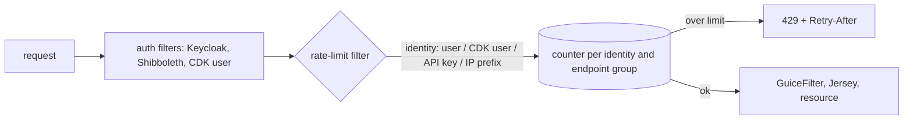

# QOL-005 — Build per-client, per-endpoint rate limiting into Kramerius, keyed by a combination of user, HTTP headers and IP

> **In one sentence:** Kramerius has no request limits of its own, so each library must put a gateway in front of it or
> go without; a rate-limit filter inside Kramerius, modelled on the gateway MZK built, would give every installation
> per-endpoint limits counted by a configurable combination of the logged-in or CDK user, HTTP header values and the IP
> prefix, using the identity Kramerius already knows.

## Today

- **Kramerius:** no rate limiting. Every request reaches Tomcat, Guice and Jersey; protection depends on what each library
  puts in front.
- **MZK:** an OpenResty gateway in the Helm chart (`kramerius-helm-chart` `46a6479`, `files/gateway/`) does it well enough to
  serve as the model:
  - rules with endpoint patterns (`*` = one path segment, most specific first), each with a rate limit (GCRA, burst as a
    fraction of the window) and an optional download quota, peak and off-peak values, bans;
  - rules stored in Redis and edited at runtime through a management API and client, no redeploy;
  - 429 with `Retry-After` and a body that states the limits.
- **What the gateway cannot do well** (`ratelimiter.lua:163–182`, `gateway_common.lua:156–185`): it counts a client either
  under a named profile (everyone matching shares one counter) or by IP. It learns the user only by calling Kramerius's
  `/user` endpoint with the bearer token, and it cannot tell CDK users apart, because their requests come from the CDK's
  addresses. Readers behind one NAT share a budget; a client changing addresses gets a fresh one.
- **Other libraries** run Kramerius without this gateway, and most without Kubernetes.

## Idea

A **rate-limit filter in Kramerius**, placed after the authentication filters and before `GuiceFilter`
(`search/web/WEB-INF/web.xml`: the Keycloak, Shibboleth and CDK user filters at `:67–122`, `GuiceFilter` at `:128`).
At that point the request's user is known, and a rejected request never reaches Jersey or the resource object graph.

1. **Identity: a combination of user, IP and HTTP headers.** Each rule defines how its counter key is built.
   - **Sources** a key can use:
     - `user`: the **authenticated user** (Keycloak or Shibboleth login);
     - `cdk-user`: the **CDK end user**, as established by the CDK filters (`CDKKeycloakFilter`,
       `CDKShibbolethForwardFilter`), which Kramerius already verifies;
     - `header:<name>`: the **value of any HTTP header** (an application or partner ID, an API key, a reading-room
       terminal header, the `User-Agent`). A header is used **only when the request comes from the CIDRs configured for
       that header** (or behind a proxy that sets it), because clients can send any header they like;
     - `ip` / `ip/<prefix>`: the **client IP** or its prefix (/24 for IPv4, /64 for IPv6), with the real IP taken from
       `X-Forwarded-For` behind trusted proxies, as the gateway does.
   - **Composite keys:** a key can join several sources, e.g. `user+ip/24` (one budget per user and network, catches shared
     accounts), `header:X-App-Id+ip` (one budget per application instance), `ip+header:User-Agent` (separates tools behind
     one NAT).
   - **Fallback order:** a rule lists keys in order, and the first whose sources are all present wins, e.g.
     `[user, cdk-user, header:X-Api-Key, ip/64]`.
   - **Matching conditions**, as the gateway's profiles: a rule or an exception can apply only to requests with given
     header values, users, roles or IP ranges (e.g. a higher limit for a reading-room header from the library's network).
   Roles can raise or remove limits (curators, admins, the CDK harvester).
2. **Rules per endpoint group**, as in the gateway: path patterns, requests per window with burst (GCRA), optional cost
   per request (e.g. a PDF counts its pages, an `info.json` or tile counts 1), peak and off-peak values, bans by user or
   prefix.
3. **Answer 429** with `Retry-After` and a short explanation, before any expensive work.
4. **Counters:** in-memory per pod to start (a limit per pod = the rule's limit divided by the number of pods, or simply per
   pod); optionally shared across pods through the Hazelcast cluster Kramerius already uses for Akubra locks.
5. **Rules at runtime:** stored in the Kramerius database, cached in each pod and reloaded on change; managed through the
   admin API and a screen in the admin client, like the gateway's management client. A default rule set ships with
   Kramerius, and **observe mode** logs would-be 429s without enforcing them.
6. **Telemetry:** a counter of allowed and rejected requests per rule and identity type, so limits can be set from data.

## Expected gain

| Use case | Today | After (rough) | Confidence | Basis |
| --- | --- | --- | --- | --- |
| all installations | no limits unless a library runs its own gateway | per-endpoint limits out of the box | high | source |
| search, image-open (fairness) | at MZK: one budget per IP or per shared profile; CDK users share the CDK's | one budget per user, per CDK user, per IP prefix | high | source |
| search, image-open (protection) | address rotation resets the budget | budget per user or per /64, /24 | medium | source |
| cost of a rejected request | at MZK: rejected in the gateway; elsewhere: full request | rejected before Jersey and Guice | medium | source |

No latency gain for admitted requests (one in-memory counter update per request).

## Pros

- Every Kramerius installation gets it, including those without Kubernetes or a gateway.
- Uses the identity Kramerius already resolves, including CDK end users, so no token lookups; header-based keys add
  integrations and terminals that have no login.
- Limits can follow roles and licences (e.g. no limit for curators, a higher one for a reading-room role).
- Rules are managed where libraries already manage Kramerius: the admin client.

## Cons and risks

- A rejected request still uses a Tomcat thread briefly; a flood of requests is better stopped earlier (a gateway or ingress
  limit stays useful as the outer layer).
- Per-pod counters are approximate with several pods; shared counters (Hazelcast) add a network call per request.
- Wrong default rules could throttle real readers: ship conservative defaults and observe mode first.
- **Header spoofing:** a header-based key or condition must only be honoured from its configured CIDRs; a misconfigured
  rule would let clients choose their own budget.
- One more admin feature to secure and document.

## Alternatives

1. **Do nothing.** Libraries without a gateway stay unprotected; MZK keeps per-IP counting.
2. **Improve only the MZK gateway** (identity templates in Lua, trusted headers for the CDK). Helps MZK, not others, and the
   gateway still has to call Kramerius to learn who a user is.
3. **Recommend an off-the-shelf gateway** (Kong, Envoy with a rate-limit service) in the installation docs. No code change,
   but a new system for every library to run, and it still cannot see CDK users.
4. **Both layers:** a coarse per-IP limit in the ingress or gateway against floods, and this filter for per-user fairness.
   This is the recommended end state for MZK.

## Effort

**Size: L.** New component in Kramerius plus a DB table and an admin API, and a screen in a second repository.

| Part | Size | Why this size |
| --- | --- | --- |
| Rate-limit filter: identity sources and composite keys, trusted-CIDR check for headers, path-pattern matching, GCRA counters, 429 response | M | New component in the search WAR; logic can follow `ratelimiter.lua` |
| Rule store: DB table, cache with reload, default rule set, observe mode | M | New table and loader in `shared/common` |
| Admin API for rules and bans | S | CRUD resource in `rest` admin v7.0 |
| Admin-client screen | M | `kramerius-admin-client` |
| Shared counters through Hazelcast | M | Optional, only for strict limits across pods |
| Metrics: allowed and rejected per rule | XS | Counters exported through the existing logs or OTel |

## How we would validate it

1. Size the default rules from MZK's NGINX logs in ClickHouse: per endpoint group, requests per minute per IP, per /24 or
   /64 prefix and (for logged-in requests) per user at peak; how many IPs carry several users.
2. Deploy in observe mode on MZK for a week and compare would-be 429s with the gateway's real ones.
3. Drop the per-user part if almost all heavy traffic is anonymous and single-IP; keep the filter for installations without
   a gateway either way.

## Open questions

- Which identity do the CDK filters establish for anonymous CDK users, and is it stable enough to count on?
- Which headers do real integrations send that would make useful keys (application IDs, terminal markers), and from which
  networks?
- Do the Kramerius maintainers prefer rules in the database (runtime) or in `configuration.properties` (simpler, needs
  restart)?
- Should the cost of a request be configurable per endpoint (e.g. pages for a PDF), or fixed at 1 to start?
