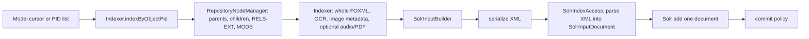

# Run 05 — parallel reads and indexing batches

## Scope and current evidence

This is a source-derived capacity plan for Kramerius search indexing and the Solr/CDK migration feeders. It uses the checked-out source, whose revision has not been matched to the deployed images. Production public pods mount Akubra object and datastream stores through NFS-class volumes, but no worker job profile, NFS client/server metric, representative FOXML sample, or controlled benchmark is yet available. **No safe concurrency level, batch size, throughput gain, or saturation point has been measured.**

## Current flow

`RepositoryNodeManager.java:38–121` builds and retains a 1,024-entry per-manager node cache. A node build checks existence, reads processing-index parents and children, RELS-EXT, model, and MODS, then recursively derives fields from parents (`RepositoryNodeManager.java:88–178`). `Indexer.java:145–169,243–328` walks a root and descendants sequentially. Per object it reads whole FOXML, checks and reads OCR, sometimes reads the next sibling's OCR to join a hyphenated word, gets image metadata, and may analyze WAV or extract PDF pages. It then builds a Solr document. These are potential NFS and CPU costs, not measured costs.

The main indexing path serializes the Solr document to XML, then `SolrIndexAccess.indexFromXmlString` parses that XML back to `SolrInputDocument` and calls `solrClient.add` once per document (`Indexer.java:303–321`; `SolrIndexAccess.java:109–142`). Solr gets `commitWithin=15000` on each add (`SolrIndexAccess.java:39,117`). Model-wide indexing fetches processing-index model pages of 100 and loops over PIDs; each `indexByObjectPid(..., true, ...)` explicitly commits after that PID (`NewIndexerProcessIndexModel.java:106–143`; `Indexer.java:145–167`). The object/PID-list process loops over PIDs and, with its default `solrSearch.commitAfterBatch=true`, commits at the end (`NewIndexerProcessIndexObject.java:130–162`). `SolrIndexAccess.deleteByIds` currently invokes `deleteById` for each ID, and `deleteById` commits, followed by another final commit (`SolrIndexAccess.java:145–163`); only benchmark this path if representative jobs actually use it.

Migration is a different path: `SimpleCopyMigrationIndexFeeder.java:87–151` and `CDKCopyMigrationIndexFeeder.java:48–102` form configurable request batches (source default 20 in `RequestConfig.java:10`) and send multi-document updates. `SolrIndexAccess.java:226–299` also has batched atomic-field update methods. The recommendation must therefore target **main FOXML indexing**, not claim that all Solr writes are unbatched.

## Parallelism boundaries

| Work | Possible parallelism | Correctness constraint |
| --- | --- | --- |
| Independent object bytes or metadata reads | Bounded prefetch of whole FOXML, OCR, RELS-EXT/MODS, and image metadata may overlap NFS waits after PIDs are known. | Bound in-flight bytes and requests. Read a coherent object version or detect concurrent writes; no mixed FOXML/datastream revision. Do not share mutable parsers, DOMs, or repository wrappers without confirming thread safety. |
| Separate top-level roots | Could use isolated indexer instances and bounded Solr submission, after deduplicating overlapping roots. | Foster relations may cause the same PID to appear in multiple traversals. Need ownership/deduplication, checkpointing, and stable parent-derived fields. |
| Parent and child node construction | Parent must be resolved before inherited fields on a child. Sibling OCR may be needed for a hyphenated word; reindexing one page can read the next page. | Build a dependency DAG or keep dependent work ordered. The current `RepositoryNodeManager` LRU, counters, report logger, and `Indexer` state are not designed as a shared parallel worker pool. |
| PDF pages | Page text could be processed separately only after validating PDFBox access and output ordering. | `PdfExtractor` wraps one `PDDocument`; isolate documents or synchronize extraction. Count temporary-file and memory pressure. |
| Solr submissions | Batch independent completed documents by both count and serialized bytes, with a bounded queue. | Preserve update order for duplicate PIDs, parent-derived fields, deletes, and explicit visibility/commit semantics. A successful add response is not the same as a visible committed document. |

## Controlled capacity run

1. **Choose jobs and data.** Record the exact deployed worker/source revision, Akubra and Solr configuration, worker CPU/memory, NFS mount/storage metrics, and current commit policy. Sample small/large FOXML and datastreams, parent depth, foster links, OCR/PDF presence, and update/delete cases. Use at least an object/PID-list job, a model-wide job, and a migration batch job. Preserve source order and a checksum/expected-document manifest.
2. **Baseline each stage.** Instrument queue wait, processing-index calls, Akubra open/read bytes and latency, XML parse/transform CPU, OCR/PDF work, XML serialization and parse-back, Solr add latency, commit latency, visibility delay, retry count, peak heap, and total job time. Record NFS read throughput/ops, metadata ops, client retransmits/timeouts, server load/latency, Solr CPU/heap/merge/commit pressure, and concurrent public IIIF/search p95/p99. Count repeated reads of the same PID/version and next-page OCR reads.
3. **NFS concurrency sweep.** In staging on representative NFS and with identical input order, compare serial reads to a small bounded sequence of prefetch limits. Sweep warm and cold page/cache states separately. Stop increasing concurrency when throughput plateaus, NFS latency/tail or retransmits rise, worker memory/CPU saturates, or public requests degrade. Keep Solr submission and commit policy fixed for this comparison.
4. **Solr batch sweep.** Hold read concurrency fixed. Compare current one-document adds with several bounded count/byte limits and queue depths; separately compare the current per-PID and per-job commit policies against a validated visibility objective. Do not combine batch and commit changes in one first comparison. Include insert, update, delete, and duplicate-PID cases. Check partial-batch errors by locating rejected documents, retrying idempotently, and resuming from a durable checkpoint.
5. **Combined validation.** Repeat the best individual candidates together only after each is understood. Run concurrent interactive image opening and searching; compare job duration, documents/s, bytes/s, index visibility, correctness manifest, NFS/Solr pressure, and public latency. Re-run after worker restart and transient NFS/Solr failure. Report run-to-run variability and the tested operating range, not a single maximum number.

The first small pilot should be **one representative PID-list indexing job** in staging, with a fixed source set and current commit policy. Start by measuring stage time and duplicate reads. If NFS wait dominates, test bounded read prefetch while keeping one writer; if Solr add/commit dominates, test a bounded multi-document submission with unchanged commit policy. Choose the variant only from these measurements. A CDK migration feeder should be a separate benchmark because it is already batched.

## Decision and dependencies

The decision is whether to prefetch independent reads, remove duplicate reads, batch main-indexer Solr submissions, alter commit frequency, or leave a stage serial. Required before recommending settings: representative staging with the same NFS behavior, deployed build/config proof, job baselines and correctness manifest, NFS and Solr metrics, a defined maximum index-visibility delay, and restart/partial-failure test access. Do not extrapolate image or search gains from indexing throughput: measure interactive p95/p99 under concurrent jobs. No capacity recommendation is ready from source inspection alone.

One adjacent correctness finding should be tracked in Run 04: `PdfExtractor.java:24–62` loads a `PDDocument` and creates a temporary PDF with `deleteOnExit`, but the class has no close method for `PDDocument` and indexing does not close the extractor. The input stream is closed. Resource growth during PDF-heavy jobs should be reproduced before any parallel PDF extraction.
