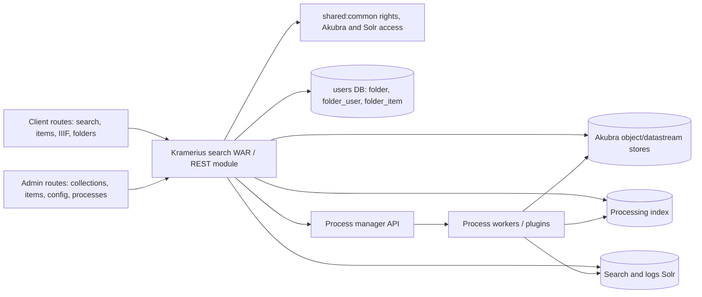
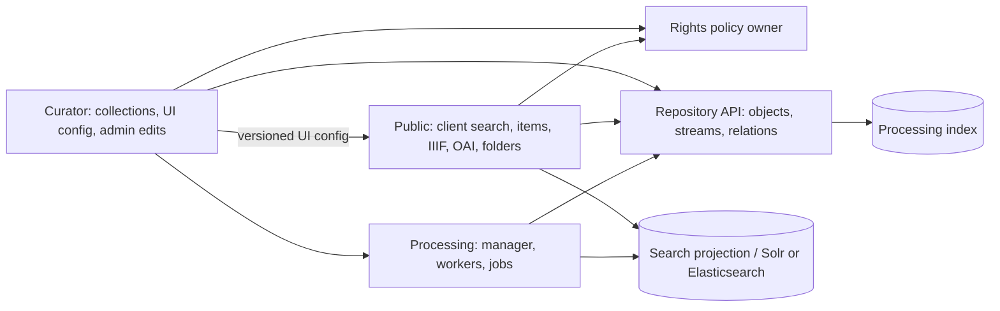

# Run 09 — Kramerius module and service boundaries

## Source map and evidence limit

This is primarily a source-derived architecture review of the checked-out tree. Its revision is not conclusively matched to the deployed image. Run 01 observed two public pods, two curator pods, separate process workers, and a manager. A subsequent read-only gateway check found that `/search/api/admin/` routes to curator and other gateway traffic to public; the public and curator pods use the same image digest (see [deployment check](11-deployment-incident-check.md)). Resource limits, DB pools, route-level access outside the gateway, and shared-resource contention are not yet measured. The public request baseline does not measure admin load. Therefore no new standalone service or speed benefit is established.

The build has `shared:common`, `rest`, `search`, `folders`, security, bridge, and many process modules (`kramerius/settings.gradle`). `search/build.gradle` assembles the WAR and depends on `rest`, `shared:common`, security, and several process modules. `rest/build.gradle` depends on `shared:common`, `folders`, search-index, and other libraries. `folders/build.gradle` depends on `shared:common`. A Gradle module is thus already a code boundary for folders, but it is not a deployment or data-ownership boundary. `ApiServletModule.java:93–207` binds client, admin, CDK, OAI, and folder endpoints in one Jersey module. The gateway route split is therefore a deployment/routing boundary, not evidence that admin handlers are absent from public pods or public handlers are absent from curator pods.

This is a dependency diagram, not a runtime call graph. Some arrows apply only to selected routes. Runs 02, 05, and 06 describe the IIIF, indexing, and manager-worker paths in more detail.

## Ownership and transaction boundaries

| Domain | Current source authority and readers/writers | Boundary consequence |
| --- | --- | --- |
| Repository objects, datastreams, relations | Akubra stores FOXML-derived objects and datastreams; client reads, admin edits, import and indexing workers read/write (`AkubraDOManager.java:118–260`; Run 07). The processing index mirrors descriptions/relations. | One logical object can be touched by multiple processes. A separate service needs a single write API or a rigorously fenced shared-storage contract, plus versioned reads and reconciliation. The Run 07 swallowed-error finding must be addressed. |
| Search and logs | Public search reads Solr; admin collection actions and index workers update search fields; access logging can write Solr (Runs 02, 05, 08). | Splitting a web process does not isolate Solr saturation or outages. An index writer owner, visibility objective, and durable change flow are needed if writers are extracted. |
| Rights, users and configuration | Shared common/security libraries and request user providers appear in both client and admin resources; collections call `RightsResolver` before mutations (`CollectionsResource.java:116–130,379–411,493–511`). | Separate deployments must use the same identity and policy semantics. Cross-process rights/cache invalidation, config versioning, and fail-closed behavior require explicit ownership. |
| Collections | Admin `CollectionsResource` writes Akubra MODS/RELS-EXT and processing index, queries and updates Solr fields, and schedules reindexing (`CollectionsResource.java:394–438,493–546,678–713`). Indexer derives collection fields, including indirect membership (`SolrInputBuilder.java:113,294–299`; `IndexationType.java:63–68`). | A collection is a repository object and search projection, not a self-contained CRUD row. A separate process needs orchestration for partial writes, idempotent reindex and rights propagation. |
| Folders | `FolderDatabase` owns SQL access to `folder`, `folder_user`, and `folder_item` through the `users` connection (`FolderDatabase.java:16–195`; `folders/src/main/resources/init_db.sql`). `EndpointFolders` exposes `/client/v7.0/folders` and uses shared `User` identity (`EndpointFolders.java:23–40`). Folder item IDs reference content by string rather than a shown DB foreign key. | This is the clearest candidate for a stronger module/data ownership boundary: its persistent state is separate from Akubra/search. A service still needs identity, item existence/deletion policy, and read authorization. |
| Process state | Manager DB owns process records, workers pull jobs and report status (Run 06). | Already a process boundary. Fix lease/recovery semantics before adding any new message or service hop from admin actions. |

There is no atomic transaction across Akubra, processing index, Solr, and process scheduling in the reviewed collection path. For example, `addItemToCollection` updates RELS-EXT under a per-PID lock, then schedules tree reindexing and updates derived license fields (`CollectionsResource.java:493–546`). `updateCollectionContainsLicensesInRepositoryAndSearchIndex` writes repository state and Solr sequentially (`:696–713`). A remote collections service would turn these into additional network failure points; it would not make the operation atomic. Define the write authority, operation ID, retry/fencing rules, event/outbox or reconciliation mechanism, and public visibility state before extraction. The optional Hazelcast lock and its lease do not replace transaction or stale-writer fencing (Run 07).

The folder SQL operations likewise use separate connections per method. Creating a folder and its owner uses two statements/methods (`EndpointFolders.java:105–145`; `FolderDatabase.java:96–118`), and deleting folder users and folder also uses separate calls (`EndpointFolders.java:244–270`). If made an independent service, make each logical mutation one DB transaction and own its schema migrations. Its schema has no shown foreign keys from `folder_item` or `folder_user` to `folder`, so orphan handling and item-deletion policy need tests. `getAllFolders`/`getFolders` calls `getFolderUsers` per row (`FolderDatabase.java:20–55`), a source-level N+1 query pattern to measure before attributing slowness to the module boundary.

One bug-audit finding surfaced here: the `folder_item` trigger is declared for INSERT, UPDATE, and DELETE, but its function recalculates `items_count` only for INSERT/UPDATE and uses `NEW.folder_uuid` (`init_db.sql:26–45`). Deleting an item therefore leaves `folder.items_count` stale. Run 04 records a reproduction gate and fix direction. Folder extraction should not propagate this inconsistency into a new API.

## Boundary options and staged proposals

| Boundary | Benefit to test | Added cost and failure mode | Provisional choice |
| --- | --- | --- | --- |
| Internal modules/interfaces within current WAR | Explicit write ownership and smaller dependency graph; can add contract tests without a network hop. | Still shares heap, threads, release cycle and database pools. Requires untangling `rest`/`search`/process build dependencies. | First step for collections and folders; make repository, indexing, rights and scheduling ports explicit. |
| Separate client and admin deployment roles, same codebase/image initially | Independent CPU/heap/thread/connection limits, scaling, rollout and administrative access control if routes are truly separated. | Duplicate baseline memory, pool connections and caches; shared Solr/Akubra/NFS/DB remain bottlenecks; routing mistakes or direct pod access can expose or break admin endpoints. | Gateway routing already separates `/search/api/admin/` from other traffic. Verify alternate ingress/direct access and actual resource isolation; pilot stronger isolation only if measured contention remains. |
| Standalone folder service, initially sharing users DB | Folder state and query load can be owned/scaled separately; narrow CRUD API is plausible. | Per-folder HTTP hop, identity propagation, duplicate DB pools, independent outages, need schema/write ownership and item cleanup policy. A shared DB without exclusive table ownership is a distributed monolith. | Candidate only if folder load, release independence or security isolation justifies cost after fixing transaction/count bugs. |
| Standalone collections service with shared Akubra/Solr/processing index | Separate release/worker resources for administration and large collection jobs. | Still has cross-store writes, rights checks, reindex scheduling, cache invalidation and consistency lag; the same storage/search pressure remains. | Defer standalone extraction. First move long-running derivation to owned jobs with idempotent status/reconciliation. |
| Dedicated read APIs or indexing projection service | May isolate search/read capacity or centralize index writes if measured contention exists. | Additional reads/serialization and consistency delay; duplicate cached state and more failure paths. | Consider after Runs 02/05/08 reveal a measured resource or ownership problem. |

## Proposed responsibility map: curator, rights, repository, processing, public

This five-part map is a useful *logical* decomposition. It covers the main write, read, and job flows if each boundary names an owner and a contract. It does not imply five new network services or five databases. UI configuration illustrates the intended distinction: admin `UIConfigResource` writes and reads `ui_config` through the `kramerius4` connection, while client `UIConfigResource` reads it (`admin/.../uiconfig/UIConfigResource.java:24–88`; `client/v70/UIConfigResource.java:30–87`; `DbUIConfigService.java:18–80`). Curator can own writes and schema, while public gets a versioned read projection or a bounded cached read. This avoids making every public page load synchronously depend on a curator pod.

| Boundary | Owns | Must expose or consume | Avoid conflating |
| --- | --- | --- | --- |
| Curator | Admin workflows: collection membership and metadata, UI-config writes, object edits/deletes, rights administration UI, job requests. | Repository mutations, rights decisions, processing job IDs/status, versioned UI config for public. | Owning a workflow is not owning the underlying repository/search/rights data. Collection operations currently span all three. |
| Rights | User/role/license policy definitions and one consistent decision contract; policy version for cache invalidation. | Identity from the auth layer, object/path/stream context from callers or repository, decisions for public and curator. | A standalone rights *service* on every IIIF or search result check could add many hops. Begin with a shared evaluator/library and one policy write owner; consider remote decisions only after call-frequency/latency measurement. B2's incomplete cache key must be resolved. |
| Repository API above Akubra | Canonical object/datastream/RELS-EXT mutations, versioning, streaming reads, write errors, locking, and processing-index synchronization/reconciliation. | Raw trusted API for curator/processing; narrower authorization-aware read facade for public. | `SecuredAkubraRepositoryImpl` itself delegates many mutations straight to Akubra and also depends on `SolrAccess` and `RightsResolver` (`SecuredAkubraRepositoryImpl.java:28–115`); it is not yet a clean isolated repository boundary. Do not expose a raw mutation endpoint to public. |
| Processing | Durable job state, scheduling, workers, retries, import/index/reindex and batch operations. | Repository changes, search-index projection updates, completion/failure status to curator. | The manager/worker split already exists. Job state and search-index ownership need explicit contracts; transport changes do not repair Run 06's lost-claim/recovery issues. |
| Public | Client APIs and presentation paths: search, item/IIIF reads, CDK forwarding, OAI/other read exports, user-facing folders, UI-config reads. | Bounded repository reads, rights evaluations, search projection, folder state, versioned UI config. | Folders are a public feature with their own SQL tables and mutations. Public-facing route placement does not mean public replicas should all own schema changes or unrestricted writes. |

The additional named responsibilities are **identity/session authority**, **search-index and access-log projections**, **folder data**, and **operations/observability**. They can be assigned to the five blocks or supporting infrastructure; they need not become separate services. For example, keep identity behind the existing authentication provider, assign search-index writes to a single projection workflow in processing, keep Solr/Elasticsearch as infrastructure, and give folder tables one owner while public exposes their API. Access logging needs its own durability and privacy contract even if processed by a worker. CDK federation, legacy servlets, OAI, statistics, image generation and external synchronization also need an explicit route/job inventory, but each can fit under public read/export or curator/processing work. The inventory, not a fixed service count, decides whether the map is complete.

Suggested order: define logical APIs and write owners inside the current codebase; verify deployed public/curator route separation; move UI-config writes and collection workflows behind curator contracts while public reads versioned projections; define repository write/read and rights policy contracts; harden processing recovery; only then test whether repository or rights merits a network boundary. Preserve the same public and admin URLs while routing evolves. A shared DB is acceptable as an interim deployment detail only with exclusive table-write ownership, schema version coordination, and no implied cross-store transaction.

### Rights as a protected-content proxy and rate-limit participant

A rights boundary could be a **policy-enforcing proxy** for protected item, IIIF, audio, PDF, or federated/CDK content: authenticate the caller, resolve the object/stream/path policy, forward an allowed request, and stream the response. This can centralize enforcement and prevent a public route from bypassing it. It must preserve range requests, streaming, cancellation, cache headers, upstream errors, and audit semantics. The checked source already performs rights checks inside `ItemsResource` and `SecuredAkubraRepositoryImpl`, while the CDK path has proxy handlers; a new proxy would consolidate or replace selected checks, not add an automatic protection layer to every current route. Map every route and test bypasses before routing traffic through it (Runs 02–03).

Rate limiting already has an ingress layer: the production gateway's Lua access handler uses per-route request limits and download-byte accounting, with Redis-backed counters and an identity chosen from a matched profile or client IP. Username resolution is enabled; its effective rules, rejected-request counts, and cost have not been measured ([deployment check](11-deployment-incident-check.md)). The rights policy owner could add *entitlements* such as license-specific quotas or concurrent-use limits, but these need a precise shared counter/lease contract and a rule for retries and token expiry. A rights proxy is one possible enforcement point for protected routes; it should not duplicate gateway quotas. Avoid making a remote rights decision or mutable global counter a mandatory hop for every tile until traces show acceptable latency and failure behavior; use a local versioned evaluator when possible. Test fail-closed behavior for protected content, quota-counter outage, token expiry, cache invalidation, and a burst of image tiles. Measure image-open p95/p99, successful throughput, denied-request accuracy, proxy CPU/network bytes, and upstream load at equal resources. No *additional rights-specific* quota requirement, threshold, or benefit has been measured yet.

For a *shared users DB* folder service, assign exclusive `folder`, `folder_item`, and `folder_user` DDL and DML ownership to that service. Other services use an API or read-only, versioned projection; no direct writes. Coordinate schema changes through backwards-compatible migrations and explicit minimum/maximum client versions. Keep owner/member/item changes transactional within that DB. Treat cross-domain item deletion or user deletion as an event/reconciliation problem with idempotent consumers and an auditable repair queue; do not presume a DB transaction spans Akubra, Solr and the users DB. For collections, the most defensible interim owner is the repository mutation workflow in the current admin/curator process, with a durable operation record and a single index-writer path; only a later independent service could own the whole workflow.

## Measurement and pilot

1. Confirm the deployed public/curator images, ingress rules, active endpoints, pod CPU/memory limits, servlet/HTTP/DB pools, caches, NFS mounts, process scheduling endpoints, and which process writes each table/store. Build a route-to-dependency trace map for client search/IIIF, folder list/detail, and collection create/edit/item changes. Use sanitized aggregates; the existing `endpoint` classification is manually curated and does not prove a resource belongs to one role.
2. For one representative day, count admin, folder, collection and client calls by route and method; measure p50/p95/p99, error classes, payload sizes, concurrency, DB queries/pool waits, CPU/GC, Solr/Akubra/NFS time, and scheduled-job lag. Inspect overlap: do admin bursts or collection reindex jobs raise public search/image latency? Correlate traces and resource metrics instead of attributing temporal overlap alone.
3. Model each candidate as `removed contention cost − added network/serialization/pool/coordination cost`, then test it in staging at equal total CPU/RAM/connection budgets. For client/admin separation, route the same requests to isolated role deployments, include a failed admin pod and shared Solr outage, and compare successful throughput, tails, resource headroom and recovery. For folders, compare a local call with an API hop under warm/cold DB caches and realistic folder/user cardinality; include owner/member authorization and transaction failure injection. For collections, replay updates with missing Solr, manager or Akubra, verify eventual derived fields and repair time before any remote-service experiment.
4. Report use-case effects separately: **indexing** job time and write/visibility lag; **image opening** direct/forwarded time-to-image and p95/p99; **searching** query throughput and p95/p99. A route split can improve only measured resource contention, not intrinsic Solr/NFS or image-server time. Folder separation is unlikely to affect indexing/image/search directly unless its current DB/pool/CPU load competes with them. Do not add benefits from cache, batching and service separation when they remove the same wait.

The first small pilot is now **validation of the existing gateway role split**: serve a fixed client search/IIIF mix and a fixed admin/collection workload on the current topology, confirm the selected backend and test direct/alternate ingress, then inject an admin-process failure while measuring public behavior and shared-dependency load. Test separately limited role deployments at equal total resources only if current limits show contention. If routing and resource isolation already meet the objective, make the next architecture change a bounded folder SQL/transaction contract test instead. No numerical gain can be stated without a contention baseline.

Decision gate: extract only when a named owner and failure contract are clear and measured isolation, scaling or release benefit exceeds extra calls and operations. Keep collections as an internal workflow until multi-store consistency is explicit. Folders have the cleanest data boundary, but source-level bugs and transaction gaps should be corrected before extraction. Required access: deployed manifests/routing/revisions, per-route and dependency traces, shared-store and DB metrics, representative admin/folder/collection requests, staging with the same NFS/Solr/DB behavior, and fault-injection authority. No runtime experiment or production change was performed in this run.
