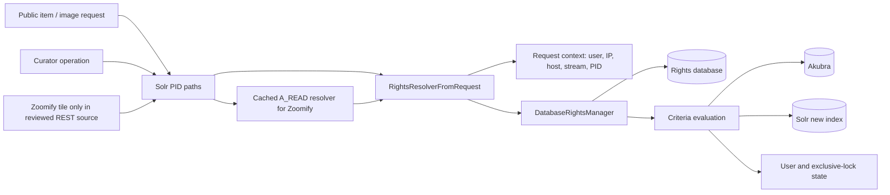

# Rights boundary — source-only dependency and freshness map

This map uses checked-out source only. It does not establish the deployed commit, latency, request volume, or a safe cache TTL. It refines the logical rights-module proposal in [Run 09](09-service-boundaries.md) and B2 in the [bug audit](04-bugs.md). No tests, production queries, or application changes were made.

## Actual call boundary

`ClientApiResource.java:101–116` first fetches all PID paths from Solr, then checks `A_READ` path by path until one allows. `RightsResolverFromRequest.java:95–107` builds a context from PID, stream, user, remote host/address, resolver and exclusive-lock maps, then calls `DatabaseRightsManager.resolve`. `DatabaseRightsManager.java:238–262` resolves rights along the injected repository path and evaluates ordered criteria. `RightCriteriumContextFactoryImpl.java:75–92` supplies Akubra, the new Solr index, user manager, and lock maps to those criteria. A network proxy would therefore need these inputs or a trusted, versioned decision request; forwarding only PID and user is insufficient.

The ordinary `RightsResolver` binding is uncached (`GuiceSecurityHTTPModule.java:32`). The named cached binding is an eager singleton (`GuiceSecurityHTTPModule.java:34`) and caches only `A_READ` (`RightsResolverFromRequestCached.java:85–116`). In the reviewed REST call sites, `ClientApiResource.checkUserByJsessionidIsAllowedToReadIIPTile` selects it, called by `ItemsResource.getZoomifyTile` at line 1195. Other datastream checks call the ordinary resolver, and the CDK calls found by search are commented out. This narrows B2's *known source exposure* to that Zoomify route; it does not prove that route's production volume or exclude other deployments/modules.

**Follow-up 2026-10-28: low.** The only caller allows when any path allows (`ClientApiResource.java:101–116`), so a cached allow always means some path allowed; the collision can only return a false deny (path 1's deny reused for path 2). A path matters only for a right assigned directly to an ancestor, since licences are indexed on the object. A revoked right can still allow for up to `cache.timeToLiveExpiration` (60 s default). The only caller is the Zoomify tile route (`ItemsResource.java:1195`), unused at MZK. No bug entry.

## Freshness and proxy contract

| Decision input or change | Source evidence | Contract before caching or proxying |
| --- | --- | --- |
| PID path and action | `ClientApiResource.java:101–116`; `DatabaseRightsManager.java:238–262` | Include the exact path/action in a decision key or aggregate all paths with the same semantics. B2 currently omits path and stream from its key. |
| Stream and request identity | `RightsResolverFromRequest.java:95–107` | Carry stream, authenticated user/roles, remote IP/host, and any session/criterion inputs needed by active policies. Do not trust client-supplied identity headers without an authenticated gateway contract. |
| Rights/criteria writes | `RightsResource.java:107–185,289–367` mutates rights and criterion parameters through `RightsManager`. | Define owner, version/epoch, cross-pod invalidation, and maximum stale-allow interval. No explicit invalidation call appears in these endpoint methods or `RightsResolverFromRequestCached`; its configured TTL is not an immediate revocation mechanism. |
| Repository/index/user/lock changes | `RightCriteriumContextFactoryImpl.java:75–92` exposes Akubra, Solr, user manager, and exclusive locks to criteria. | Inventory active criteria before setting cache keys and invalidation rules; decide which data is read live, versioned, or deliberately uncached. |
| Logging metadata | `RightsResolverFromRequest.java:103–107` stores the resolved decision in a thread-local used by access logging (B4). | A proxy response must carry the decision metadata needed for logs explicitly, with a clear request lifetime; avoid carrying Java request/thread-local objects across a service boundary. |

The current cache key is PID, `User`, and IP with a configured TTL and local heap/off-heap storage (`RightsResolverFromRequestCached.java:31–82`). There is no source evidence here of a cross-pod invalidation protocol. A rights proxy can also enforce a quota for protected content, but define the unit first (request, image tile, bytes, user/session/license), the authorization decision order, and failure behavior. Rate limiting should not change allow/deny semantics or silently grant access if the proxy is unavailable. Existing gateway limiting is a separate layer ([deployment check](11-deployment-incident-check.md)).

## Decision enabled

The smallest source-consistent next design is an **internal rights module contract**: keep the public/curator call sites local initially, make decision inputs and output explicit, and define mutation-driven freshness. Independent deployment or a protected-content proxy is justified only after route volume, rights-stage time, cross-pod freshness requirements, and operational ownership are known. For the separate benchmarking environment, use representative path/stream/user/IP/criterion combinations and compare end-to-end image opening and protected-content success, not just resolver microseconds. This document adds no measured gain or rollout recommendation.
