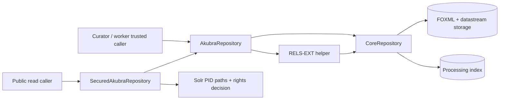

# Repository API boundary above Akubra — source-only map

This map refines the repository block in [Run 09](09-service-boundaries.md). It follows the checked-out Akubra API and Kramerius security wrapper; deployed revision, call volume, and failure incidence remain unknown. No tests, production queries, or application changes were made.

`AkubraRepository` is the broad object/datastream API (`AkubraRepository.java:37–349`). `AkubraRepositoryImpl` delegates to `CoreRepository` and exposes `pi()` and `re()` directly (`AkubraRepositoryImpl.java:273–292`). `CoreRepositoryImpl` coordinates object storage and the processing index; `AkubraDOManager` owns low-level storage, FOXML marshalling, and optional per-PID Hazelcast locks (`CoreRepositoryImpl.java:101–158`; `AkubraDOManager.java:406–435`). Kramerius's `SecuredAkubraRepositoryImpl` adds Solr-path and rights checks for selected reads (`SecuredAkubraRepositoryImpl.java:177–209,289–329`) but delegates many mutations directly to the raw repository (`:53–135`). It is a read-security facade in the reviewed methods, not a complete trusted mutation boundary.

## New source finding

**B24 / high — datastream update has a delete/create failure window.** `AkubraRepositoryImpl.updateXMLDatastream`, `updateManagedDatastream`, and `updateExternalDatastream` acquire a PID lock, fetch the object, call `coreRepository.deleteDatastream`, then call a separate `create...Datastream` method (`AkubraRepositoryImpl.java:134–180,199–211`). `CoreRepositoryImpl.deleteDatastream` delegates to `AkubraDOManager.deleteStream` (`CoreRepositoryImpl.java:283–291`), which can remove managed bytes before rewriting FOXML (`AkubraDOManager.java:189–215`). If creation fails after deletion, the old stream or its content can be missing. The lock serializes callers but does not roll back storage or processing-index changes. B9's swallowed storage exceptions make the exact observed outcome less predictable. For a missing object, the update methods return without error after a null lookup; that caller-visible no-op is another contract ambiguity.

Later validation in the separate environment should inject failures after old-stream deletion and during managed-byte/FOXML write. Compare old and new FOXML, referenced bytes, RELS-EXT processing-index relations when relevant, method result, and retry outcome. Design direction: stage replacement content, atomically switch a versioned reference where storage permits, and retire old bytes only after the new object and processing projection are durable; otherwise define explicit compensation and reconciliation. Do not assume the current PID lock supplies transactionality.

## Contract for a logical repository module

| Operation class | Current source behavior | Boundary requirement |
| --- | --- | --- |
| Object/FOXML reads | `AkubraRepositoryImpl.get` loads object bytes and returns a wrapper; `export` resolves archived streams into an object archive (`:63–94`). | Distinguish lightweight metadata, FOXML bytes, and expanded export. Preserve streaming and content/version metadata; bound export size and latency. |
| Datastream reads | `getDatastreamContent` returns an input-stream wrapper (`:235–248`). Secured wrapper checks Solr PID paths and rights for configured streams before delegating. | Expose an authorization-aware public read facade separately from trusted raw reads; preserve streaming, range/cancellation semantics where callers require them. |
| Object ingest/delete | `AkubraRepositoryImpl.ingest` writes through core and commits the processing index (`:52–57`). Delete spans object storage and processing-index removals (`CoreRepositoryImpl.java:136–158`). | One write owner, explicit success/failure semantics, operation IDs, idempotent retries, and reconciliation for partial storage/index results. B9 and B20 remain gates. |
| Datastream/RELS-EXT mutations | Update uses delete then create (B24). `re()` and `pi()` expose helpers and mutable processing-index operations directly. | Offer intent-level mutation methods with version checks; keep raw index mutation private to the module. Publish a durable change/version for search-index projection rather than letting every caller coordinate several stores. |
| Per-PID locking | `doWithLock` delegates to optional Hazelcast lock with lease (`AkubraDOManager.java:406–435`). | Define stale-writer fencing and recovery. A lock release or expiry is not a commit marker, and a remote service must not ask clients to hold a Java callback/lock across network hops. |

The repository module should first be a **logical ownership boundary** inside the current deployment: trusted writers use explicit operations, public readers use narrow secured methods, and processing owns the search projection. A remote repository service is a later option only after B9/B17/B20/B24 failure semantics, versioning, index reconciliation, and streaming contracts are settled. The module's performance effect cannot be inferred from source: measure FOXML/datastream read bytes and time, NFS/processing-index load, extra network serialization if remote, indexing job time, image opening, and search visibility separately. No numerical improvement or extraction decision follows from this map alone.
