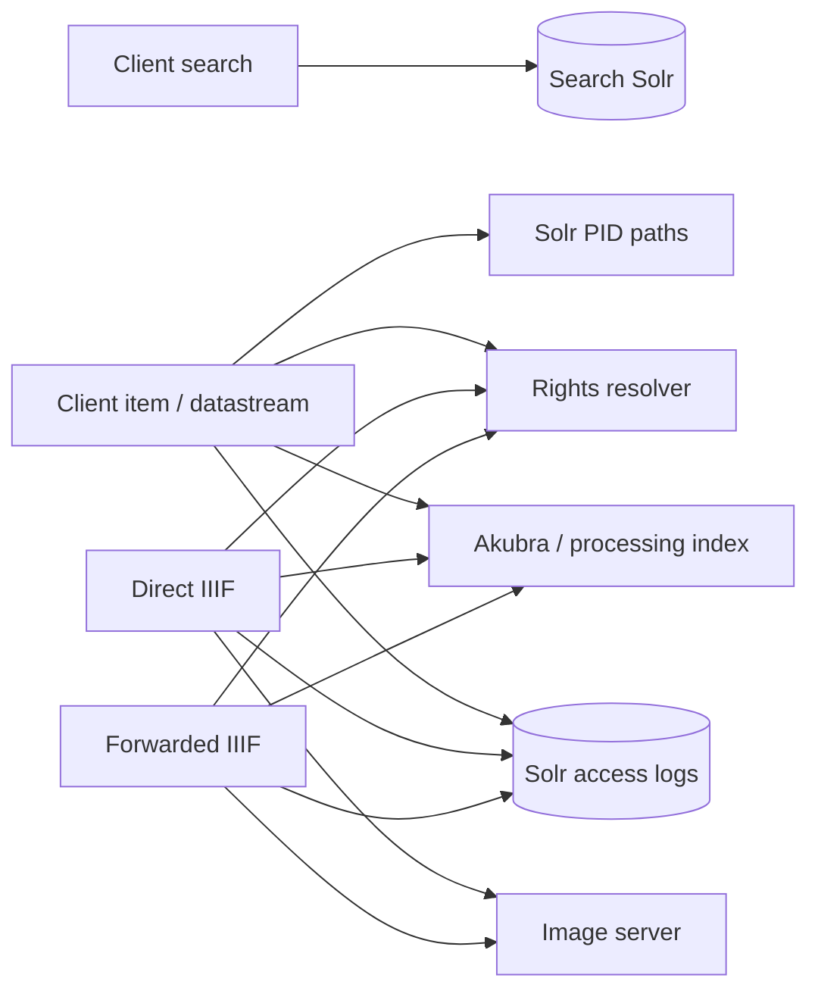

# Public read boundary — source-only route and dependency map

This completes the source-level public side of the curator/rights/repository/processing/public map. It follows checked-out REST code, not a revision-matched deployed image. No tests, production queries, or application changes were made. Runtime frequency, active rights criteria, and measured stage costs remain unknown.

`SearchResource.get` builds and forwards a Solr query, then transforms its JSON/XML response (`SearchResource.java:102–203`). B11 covers its deployed Solr-400 status mapping. `ItemsResource` uses Akubra/processing-index reads for item info, MODS/DC/OCR, thumbnails and image metadata, plus rights checks and access logging for protected streams (`ItemsResource.java:230–335,374–615,1213–1251`). Direct and forwarded IIIF metadata have source and sampled runtime evidence of Solr paths/rights, Akubra tiles URL, access-log work, and an image-server request ([Run 02](02-iiif-logging.md), [runtime paths](13-iiif-runtime-paths.md)). These are route-specific dependencies; a public service split does not remove shared Solr, NFS/Akubra, or image-server costs.

## New source finding

**B26 / high, policy-dependent — item datastream helper discards the stream ID before authorization.** `ClientApiResource.checkUserIsAllowedToReadDatastream(pid, datastreamId)` obtains `dsId` but calls `userIsAllowedToRead(user,pid)` (`ClientApiResource.java:50–59`). That helper eventually calls `RightsResolver.isActionAllowed(..., pid, null, path)` for each Solr PID path (`:101–116`). By contrast, `RightsResolverFromRequest.java:103–107` passes the supplied stream into the criterion context, and `SecuredAkubraRepositoryImpl.java:177–209` passes `dsId` for secured streams. Client item routes such as OCR text and full image call the null-stream helper, then read through `ApiResource.akubraRepository`, which is the raw `AkubraRepository` (`ItemsResource.java:471–478,575–584`; `ApiResource.java:22`). If an active policy allows object read but denies a particular stream, this path can make the wrong decision. Whether such policies are configured and whether the deployed image has this code are unverified.

**Follow-up 2026-10-28: no effect with the shipped criteria.** No criterion reads the stream: `RightCriteriumContext.getRequestedStream()` has no callers, and `SecuredStreams` always evaluates TRUE; stream names only decide whether a check runs (`SecuredAkubraRepositoryImpl.getDatastreamContent`, `SecuredAkubraRepositoryImpl.java:179–200`), and these routes always check. The null stream gives the same decision as the secured repository would. Only a custom stream-aware criterion would be affected; none is known (MZK sets no per-stream rights). No bug entry.

Before changing the contract, compare all stream-specific criteria and route semantics. The logical authorization input must include PID, exact path, stream, user, request context, and action; public handlers should use an authorization-aware repository facade or pass a verified decision to a narrow raw read. B2's cache-key omission is related but separate. Later validation belongs in the separate benchmarking environment with two streams under opposite policy decisions and with both public pods.

## Public-module contract

| Concern | Contract for any logical or deployed split |
| --- | --- |
| Search | Own request parsing/response shape, not the index writer. Preserve query/facet/highlight semantics and errors; keep healthy latency separate from incident availability. Search-response caching requires index generation and authorization scope ([Run 03](03-cache-matrix.md)). |
| Item/IIIF reads | Route-specific authorization with path and stream, bounded repository reads, streaming/cancellation, cache freshness after curator/worker writes. Keep direct and forwarded IIIF paths distinct when measuring. |
| Access logs | Define synchronous versus queued delivery, failure visibility, ordering and retention. A log write occurs before image-server GET in sampled successful `info.json` traces, but its elapsed share is unknown. |
| Public versus curator deployment | Gateway routing already separates admin paths from other traffic, yet both roles use the same image ([deployment check](11-deployment-incident-check.md)). A logical public boundary should first remove raw mutation capabilities from public call sites and clarify read contracts; measured contention must justify stronger deployment isolation. |

The next evidence gate is a route-to-dependency profile in the separate environment: direct/forwarded IIIF, item image/OCR/metadata, and search. Report component times, bytes, statuses, authorization outcome, and public p95/p99 under representative indexing/curator load. Use the [benchmark handoff](19-benchmark-handoff.md) for workload and telemetry rules. No numerical speed claim or additional service is recommended from this source map alone.
